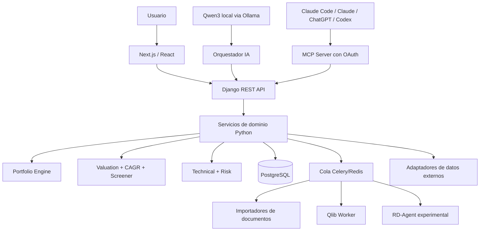
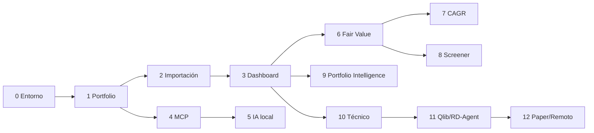

# AI Stock Intelligence
## Plan maestro, fundamento teórico, arquitectura de software y hoja de ruta

> **Documento rector del proyecto.** Integra los objetivos y decisiones acordados: carteras reales en **GBM Trading USA** y **criptomonedas de Mercado Pago**, importación/exportación, análisis fundamental, *fair value*, CAGR, revisión de gráficas, portafolios, trading simulado, inteligencia artificial local, Microsoft Qlib/RD-Agent(Q), metodología de Anthropic Financial Services, Day Trader Skill y servidor MCP accesible desde Claude y ChatGPT cuando las respectivas plataformas y planes lo permitan.
>
> **Estado:** arquitectura y requerimientos propuestos, todavía pendientes de implementación, pruebas de hardware y validación de los formatos reales de los brokers. Las decisiones numeradas se pueden revisar mediante ADRs (*Architecture Decision Records*).

**Fecha de referencia:** 14 de noviembre de 2026. **Propietario funcional:** inversionista particular que opera en GBM Trading USA y Mercado Pago. **Objetivo de despliegue:** local primero, remoto después. **Ampliación v4.2:** registro de ventas parciales, fraccionarias y totales, conciliación de nuevas importaciones y expediente fiscal auxiliar para el SAT. **Regla transversal:** los cálculos y los datos verificables prevalecen sobre cualquier explicación de un LLM.

---

## Índice

1. [Introducción y justificación](#1-introducción-y-justificación)
2. [Problema, hipótesis y objetivos](#2-problema-hipótesis-y-objetivos)
3. [Alcance, usuarios y principios](#3-alcance-usuarios-y-principios)
4. [Fundamento teórico de análisis de acciones](#4-fundamento-teórico-de-análisis-de-acciones)
5. [Teoría y métodos de Fair Value](#5-teoría-y-métodos-de-fair-value)
6. [Screener de acciones potencialmente infravaloradas](#6-screener-de-acciones-potencialmente-infravaloradas)
7. [CAGR, retornos y precio máximo de compra](#7-cagr-retornos-y-precio-máximo-de-compra)
8. [Construcción y análisis de portafolios](#8-construcción-y-análisis-de-portafolios)
9. [Gráficas, análisis técnico y trading](#9-gráficas-análisis-técnico-y-trading)
10. [IA local, Qlib y agentes de investigación](#10-ia-local-qlib-y-agentes-de-investigación)
11. [Datos externos, importación y exportación](#11-datos-externos-importación-y-exportación)
    - [11.6. Nuevas importaciones y conciliación de ventas](#116-nuevas-importaciones-y-conciliación-de-ventas)
12. [Requisitos funcionales y experiencia de usuario](#12-requisitos-funcionales-y-experiencia-de-usuario)
13. [Arquitectura técnica definitiva](#13-arquitectura-técnica-definitiva)
14. [Modelo lógico de datos y contabilidad](#14-modelo-lógico-de-datos-y-contabilidad)
    - [14.5. Registro fiscal de ventas y expediente SAT](#145-registro-fiscal-de-ventas-y-expediente-sat)
15. [API y contratos de servicios](#15-api-y-contratos-de-servicios)
16. [Servidor MCP, tokens y clientes externos](#16-servidor-mcp-tokens-y-clientes-externos)
17. [Dos computadoras y despliegue con Docker](#17-dos-computadoras-y-despliegue-con-docker)
18. [Skills y herramientas de revisión de código y UI](#18-skills-y-herramientas-de-revisión-de-código-y-ui)
19. [Plan maestro de etapas 0–12](#19-plan-maestro-de-etapas-012)
20. [Versiones, dependencias y prioridades](#20-versiones-dependencias-y-prioridades)
21. [Pruebas, métricas, definición de terminado](#21-pruebas-métricas-definición-de-terminado)
22. [Seguridad, privacidad y riesgos](#22-seguridad-privacidad-y-riesgos)
23. [Casos de uso de extremo a extremo](#23-casos-de-uso-de-extremo-a-extremo)
24. [Costos y decisiones aún pendientes](#24-costos-y-decisiones-aún-pendientes)
25. [Primeras tareas ejecutables](#25-primeras-tareas-ejecutables)
26. [Glosario](#26-glosario)
27. [Fuentes y documentación de referencia](#27-fuentes-y-documentación-de-referencia)

---

# 1. Introducción y justificación

## 1.1. ¿Por qué se quiere realizar este proyecto?

El mercado de valores ofrece acceso a empresas, fondos y otros instrumentos que pueden generar crecimiento patrimonial, ingresos por dividendos y exposición a distintos sectores económicos. Sin embargo, invertir de manera informada requiere integrar información dispersa: precios, estados financieros, perspectivas de negocio, riesgo, dividendos, transacciones, noticias, indicadores técnicos y resultados históricos.

Para una persona que invierte con recursos propios, esa información suele encontrarse repartida entre plataformas diferentes: el broker para consultar posiciones, sitios financieros para revisar gráficas, estados de cuenta para conocer el costo real, hojas de cálculo para medir rendimientos y herramientas de inteligencia artificial para interpretar datos. Cada fuente presenta una visión parcial y puede utilizar unidades, fechas o metodologías distintas. Como resultado, tomar decisiones fundamentadas exige trabajo manual, genera riesgo de errores y dificulta comprobar si una idea de inversión fue correcta.

**AI Stock Intelligence nace para solucionar esa fragmentación.** Su propósito es construir una plataforma personal, verificable y extensible que vincule la administración real de inversiones con el análisis financiero, la investigación cuantitativa y las capacidades de una IA ejecutada localmente.

El proyecto no pretende ser una aplicación que indique sin evidencia “compra esta acción porque subirá”. Busca responder preguntas más exigentes:

- ¿Qué activos poseo realmente, cuánto pagué y cuál es mi rendimiento neto?
- ¿La empresa es financieramente sólida y qué riesgos enfrenta?
- ¿Cuál podría ser su rango de valor intrínseco bajo supuestos explícitos?
- ¿Está cotizando con margen de seguridad o con expectativas excesivas?
- ¿Qué rentabilidad anualizada podría obtener si compro a cierto precio y se cumplen determinados escenarios?
- ¿Qué sugieren las tendencias, el volumen y la volatilidad de su gráfica para mi horizonte de inversión?
- ¿Cómo afectaría una compra o venta al riesgo conjunto de mi portafolio?
- ¿Qué resultados históricos respaldan una señal o un modelo predictivo?
- ¿Qué partes del análisis son datos, cálculos, supuestos o interpretaciones de un modelo de lenguaje?

Una plataforma que responde de forma consistente estas cuestiones es útil aun si no llega a ejecutar órdenes bursátiles reales. La calidad del proceso de decisión es el valor central del producto.

## 1.2. Motivación tecnológica

Las herramientas de IA pueden resumir informes, explorar hipótesis, ayudar a programar modelos y coordinar consultas. Sin embargo, las suscripciones y los servicios de inferencia externos pueden generar costos recurrentes y dependencia de proveedores. Por eso se busca una **arquitectura local-first y model-agnostic**: ejecutar un modelo abierto cuando sea suficiente y, de manera opcional, conectar clientes como Claude o ChatGPT a través de un servidor MCP propio.

El proyecto utilizará Python en el backend financiero porque el ecosistema cuantitativo ya concentra ahí librerías maduras de datos, estadística y aprendizaje automático. Mantendrá JavaScript/React en el frontend para construir una interfaz moderna. Contenedores Docker aportarán reproducibilidad entre las dos computadoras de desarrollo y una futura infraestructura remota.

## 1.3. Aportación propuesta

La aportación no consiste en inventar una fórmula infalible para predecir precios. Consiste en integrar en una misma arquitectura:

1. **Contabilidad reproducible** de inversiones reales.
2. **Valoración fundamental transparente**, con varias metodologías y escenarios.
3. **Cálculo de rentabilidad personal y proyectada**, incluyendo el precio máximo teórico de compra.
4. **Análisis técnico auditable**, separado del análisis fundamental.
5. **Investigación cuantitativa experimental** mediante Qlib y, posteriormente, RD-Agent(Q).
6. **Asistente local** que consulta herramientas sin alterar los cálculos.
7. **Interoperabilidad MCP** para Claude, ChatGPT y otros clientes autorizados.
8. **Evidencia histórica** para evaluar las predicciones antes y después de las decisiones.
9. **Libro de ventas y expediente fiscal auxiliar** que preserve cada enajenación, concilie operaciones manuales con importaciones posteriores y facilite la revisión anual con un contador.

El sistema podrá evolucionar desde una herramienta personal hasta un producto de análisis financiero más amplio; cualquier uso multiusuario o comercial requerirá revisar licencias de datos y obligaciones normativas.

# 2. Problema, hipótesis y objetivos

## 2.1. Planteamiento del problema

La evaluación de inversiones personales presenta los siguientes problemas: información fragmentada, diferencias entre rendimientos reportados, ausencia de un historial contable estandarizado, criterios de valoración inconsistentes, sesgos al interpretar gráficos y escasa trazabilidad en las recomendaciones generadas por modelos de IA. Además, el uso de múltiples aplicaciones dificulta estudiar la cartera como un conjunto y comprobar si un modelo realmente aporta valor frente a alternativas simples.

## 2.2. Hipótesis de trabajo

> Una plataforma que combine datos financieros normalizados, cálculos deterministas, métodos de valoración contrastables, análisis técnico y modelos cuantitativos evaluados fuera de muestra puede mejorar la **consistencia, trazabilidad y reproducibilidad** del análisis de inversiones personales frente a un flujo manual fragmentado.

La hipótesis se evaluará con indicadores de calidad y utilidad del sistema; **no presupone que se obtendrán rendimientos bursátiles superiores ni que un LLM puede pronosticar consistentemente precios**.

## 2.3. Objetivo general

Diseñar, implementar y validar una plataforma web de inteligencia bursátil que administre inversiones personales en acciones, ETFs y criptomonedas; integre valoración fundamental, proyecciones de rendimiento, análisis técnico y modelado cuantitativo; y exponga sus funciones por una API y un servidor MCP seguro, utilizando principalmente infraestructura y modelos de IA ejecutables localmente.

## 2.4. Objetivos específicos

1. Registrar y conciliar operaciones de GBM Trading USA y criptomonedas de Mercado Pago.
2. Importar y exportar movimientos mediante formatos estructurados y documentos verificables.
3. Calcular posiciones, costos, dividendos, ganancias realizadas/no realizadas, TWR y XIRR. Registrar ventas parciales, fraccionarias y totales y preparar reportes fiscales auxiliares por ejercicio, diferenciados de los cálculos contables.
4. Obtener y versionar cotizaciones, estados financieros, datos de divisas y eventos corporativos.
5. Desarrollar DCF, DDM, valoración relativa, Reverse DCF y Fair Value v1.
6. Implementar calculadoras CAGR históricas, proyectadas e inversas, con dividendos e inflación.
7. Crear un screener con Piotroski F-Score, métricas fundamentales, incertidumbre y consenso externo cuando exista licencia de datos.
8. Analizar diversificación, exposición agregada, solapamiento de ETFs y escenarios de mercado.
9. Desarrollar gráficos y señales técnicas reproducibles para inversión, swing y day trading.
10. Integrar un LLM local para explicación, RAG y coordinación de herramientas.
11. Experimentar con modelos cuantitativos de Qlib y con investigación automatizada de RD-Agent(Q).
12. Ofrecer MCP con permisos, OAuth y trazabilidad para clientes externos.
13. Validar seguridad, calidad de los datos, resultados financieros, facilidad de uso y rendimiento en las dos PCs.

## 2.5. Criterios de éxito de producto

- Las posiciones y efectivo deben conciliar con documentos de referencia o mostrar claramente las diferencias.
- Una misma entrada financiera debe producir el mismo resultado numérico cualquiera que sea el cliente (web, Qwen3, Claude o ChatGPT).
- Cada valoración debe documentar sus supuestos, fecha, moneda, modelo, versión y fuentes.
- La importación repetida de un archivo no debe generar operaciones duplicadas.
- Un modelo predictivo debe poder reconstruirse y evaluarse **fuera de muestra**, neto de costos.
- Los módulos fundamentales deben funcionar aunque el servidor de IA esté apagado.
- La aplicación debe ejecutarse en ambas computadoras con configuraciones distintas, sin ramas de código divergentes.

# 3. Alcance, usuarios y principios

## 3.1. Usuario principal y fuentes

**Usuario inicial:** inversionista particular en México con posiciones en:

- **GBM Trading USA**: acciones estadounidenses, fracciones, ETFs y, cuando corresponda, ADRs.
- **Mercado Pago México**: criptomonedas directas; se registrarán compras, ventas, tenencias, transferencias y posibles comisiones según los datos reales que estén disponibles.

Se utilizará **MXN como moneda de presentación principal** y se conservarán importes originales por activo, especialmente USD para Trading USA. Se podrá cambiar el dashboard a USD sin alterar operaciones ni bases de costo.

El usuario quiere **inversión de largo plazo y trading**, por lo que el sistema separará horizontes, estrategias y carteras lógicas.

## 3.2. Alcance incluido

- Registro y lectura de operaciones y balances, importación/exportación, informes PDF.
- Análisis de empresas y de ETFs/cripto con metodologías específicas.
- Valoraciones, screeners, CAGR y simulación de portafolios.
- Gráficas y alertas, diario de decisiones, paper trading.
- IA local, investigación cuantitativa y MCP con permisos.
- Despliegue local y posterior modalidad remota segura.

## 3.3. Fuera del alcance inicial

- Envío automático de órdenes reales a GBM o Mercado Pago.
- Custodia de claves privadas de wallets o movimiento de fondos.
- Trading de alta frecuencia o garantías de cotización consolidada en milisegundos.
- Predicciones de rentabilidad garantizada.
- Asesoría fiscal personalizada automatizada o declaraciones tributarias oficiales.
- Extracción mediante login privado o scraping de cuentas financieras sin autorización expresa.
- Construir un modelo fundacional de lenguaje desde cero.

## 3.4. Principios no negociables

1. **Correctitud antes que apariencia:** cifras contables conciliadas antes del dashboard vistoso.
2. **Determinismo:** el LLM no decide aritmética ni inventa valores financieros.
3. **Trazabilidad:** toda cifra conserva fuente, tiempo y versión.
4. **Separación de responsabilidades:** valuation, trading, riesgo y ML son servicios lógicos diferentes.
5. **Seguridad por defecto:** lectura y simulación, nunca órdenes reales sin una fase futura específica.
6. **Local-first:** la aplicación funciona sin una API comercial de IA.
7. **Portabilidad:** las configuraciones del equipo no contaminan el código.
8. **Evidencia empírica:** un modelo que suena convincente no equivale a ventaja estadística.

# 4. Fundamento teórico de análisis de acciones

## 4.1. Acción, precio y valor

Una acción es una participación en el capital de una compañía. Su **precio de mercado** es la cotización a la que puede negociarse en un momento dado; no es necesariamente una estimación independiente del valor económico del negocio. El análisis fundamental investiga cuánto podría valer la participación mediante expectativas de flujo, beneficios, activos y riesgo.

Las dos perspectivas principales del proyecto son:

- **Análisis fundamental:** empresa, negocio, calidad de resultados, flujos, deuda, competencia, crecimiento y valoración.
- **Análisis técnico:** evolución de precios, volumen, tendencias, volatilidad, liquidez y patrones definidos mediante reglas.

Se complementan, pero miden cosas distintas. Una empresa puede tener buena calidad financiera y una acción con precio excesivo; una acción aparentemente barata puede estar experimentando deterioro fundamental.

## 4.2. Qué revisar de una empresa

| Área | Preguntas | Datos principales |
|---|---|---|
| Modelo de negocio | ¿Cómo gana dinero? ¿Quiénes son sus clientes? | Segmentos, productos, concentración |
| Ventaja competitiva | ¿Posee barreras de entrada sostenibles? | Márgenes, cuota, retornos del capital |
| Crecimiento | ¿Ingresos y beneficios crecen de forma sana? | Revenue, EPS diluido, FCF |
| Rentabilidad | ¿Convierte ventas en ganancias y efectivo? | Margen bruto/operativo/neto, ROIC, ROE |
| Balance | ¿Puede enfrentar escenarios adversos? | Efectivo, deuda, vencimientos, liquidez |
| Flujo de caja | ¿Financia inversión y distribuciones? | CFO, CapEx, FCF, capital de trabajo |
| Capital accionario | ¿Hay dilución o recompras? | Acciones diluidas y en circulación |
| Valoración | ¿Cuánto descuenta el precio actual? | DCF, múltiplos, Reverse DCF |
| Catalizadores | ¿Qué eventos pueden alterar hipótesis? | Earnings, tasas, regulación, lanzamientos |
| Riesgos | ¿Qué invalidaría la tesis? | Competencia, endeudamiento, tipo de cambio |

## 4.3. Calidad de beneficios y documentos

Se priorizarán informes y fuentes primarias: **10-K, 10-Q, 20-F, 6-K**, estados auditados y hechos XBRL de **SEC EDGAR** cuando correspondan. Las notas a estados financieros y el informe de auditoría forman parte del análisis, no solo las cifras resumidas.

El proyecto deberá distinguir:

- **Periodo económico** del dato (por ejemplo, trimestre fiscal).
- **Fecha de publicación** y momento desde el cual el dato fue observable.
- Moneda, unidades, criterio GAAP/IFRS y revisiones posteriores.
- Datos de doce meses móviles (TTM) frente a último ejercicio completo.
- Utilidad contable frente a efectivo realmente generado.

Esta doble dimensión temporal es decisiva para el backtesting: no se podrá usar información publicada después de la fecha simulada.

## 4.4. Ratios iniciales

- **P/E:** precio por acción / utilidad por acción; carece de utilidad directa con EPS negativo.
- **P/FCF:** capitalización / flujo de caja libre atribuible; requiere definir cuidadosamente qué FCF se usa.
- **P/S:** capitalización / ventas; no incorpora directamente márgenes.
- **EV/EBITDA:** valor de empresa / EBITDA; útil en comparables, con limitaciones ante CapEx y diferencias contables.
- **ROIC:** beneficio operativo después de impuestos respecto al capital invertido; su construcción debe quedar documentada.
- **ROE:** utilidad neta / patrimonio promedio; clave en entidades financieras pero sensible al apalancamiento.
- **Deuda neta/EBITDA:** indicador aproximado de apalancamiento, con excepciones para bancos.
- **FCF yield:** flujo de caja libre frente al precio o capitalización, según definición documentada.

## 4.5. Noticias, consenso y análisis cualitativo

Las noticias no bastan para anticipar el precio. El sistema clasificará eventos según su relevancia económica, fiabilidad, fecha de publicación y si ya eran conocidos. El consenso de analistas representa expectativas externas, no una verdad objetiva ni un porcentaje de éxito. Daremos acceso a tesis alcista, bajista y neutral, además de una lista de argumentos que podrían refutar cada escenario.

# 5. Teoría y métodos de Fair Value

## 5.1. Definiciones fundamentales

El **fair value** (valor razonable o valor intrínseco estimado, según el contexto) es un resultado *condicionado por hipótesis*, no un precio verdadero directamente observable. Debe expresarse con un rango de escenarios, una fecha, una moneda y un nivel de confianza basado en calidad de datos y sensibilidad del método.

Para precio de mercado `P` y valor estimado `V`:

```text
Margen de seguridad = (V - P) / V
Potencial hasta valor estimado = (V / P) - 1
```

Ejemplo ilustrativo: si P = 90 USD y V = 120 USD, el margen de seguridad es 25% y la subida implícita hasta el valor estimado es 33.33%. Ninguno de ellos representa ganancia asegurada.

## 5.2. DCF — Descuento de flujos de efectivo

El método DCF estima el valor presente de flujos de efectivo futuros. Para empresas no financieras puede utilizar **FCFF (flujo libre para la firma)** descontado al **WACC (costo promedio ponderado de capital)**:

```text
Enterprise Value = Σ[ FCFF_t / (1 + WACC)^t ] + TV_n / (1 + WACC)^n
TV_n (perpetuidad) = FCFF_(n+1) / (WACC - g)
Valor por acción ≈ (EV - deuda neta - otros derechos + ajustes de activos) / acciones diluidas
```

La fórmula exige consistencia: flujos nominales con descuento nominal, moneda y riesgo de país compatibles, crecimiento terminal sostenible y `WACC > g` si se usa perpetuidad. El puente de EV al equity no consiste siempre únicamente en restar deuda: pueden existir participaciones minoritarias, inversiones no operativas, pensiones, arrendamientos o instrumentos dilutivos.

**Variables principales:** ventas, crecimiento, margen operativo, impuestos, depreciación, CapEx, capital de trabajo, recompras, dilución, WACC y crecimiento terminal. Se generarán escenarios pesimista/base/optimista y matrices de sensibilidad WACC × g.

**Cuándo confiar más:** flujos relativamente previsibles, datos completos, negocio entendible. **Cuándo confiar menos:** empresas extremadamente cíclicas, flujos persistentemente negativos, restructuración, alta incertidumbre terminal o transición de modelo de negocio.

## 5.3. DDM — Dividend Discount Model

Para compañías que reparten dividendos sostenibles, la variante de Gordon considera:

```text
V0 = D1 / (r - g)
```

`D1`: dividendo esperado del siguiente periodo; `r`: costo de capital propio; `g`: crecimiento sostenible del dividendo. Requiere `r > g` y consistencia de moneda, inflación y horizonte.

Una empresa sin dividendos **no carece de valor** por ello; simplemente puede no ser apropiada para este DDM. Se podrán agregar DDM de dos o tres etapas para empresas con periodos de crecimiento diferenciados.

## 5.4. Valor relativo por múltiplos

Se tomarán comparables del mismo sector/modelo de negocio, procurando controlar crecimiento, rentabilidad, riesgos y políticas contables.

| Método | Valor implícito básico | Advertencia |
|---|---|---|
| P/E | EPS futuro × P/E objetivo | No usar mecánicamente con EPS ≤ 0 |
| P/FCF | FCF/acción × múltiplo objetivo | Normalizar FCF y dilución |
| P/S | Ventas/acción × múltiplo objetivo | Revisar márgenes y deuda |
| EV/EBITDA | EBITDA × múltiplo; después EV→equity | No ignora CapEx/arrendamientos |
| P/B | Valor en libros/acción × múltiplo | Particularmente útil para bancos |

**Riesgo metodológico:** una empresa puede parecer barata respecto a un sector que en conjunto esté sobrevalorado. Por eso nunca será el único método.

## 5.5. Reverse DCF

Invirtiendo el DCF, se calcularán los supuestos necesarios para justificar el precio actual: crecimiento, margen futuro o generación de caja implícitos. Esto es especialmente útil en compañías de alto crecimiento cuyos múltiplos absolutos parecen elevados.

## 5.6. ASI Fair Value v1 — modelo propio

**ASI Fair Value v1 es una propuesta del proyecto, no un modelo publicado ni validado previamente.** Funcionará como una capa de selección y contraste de metodologías, no como un promedio opaco.

Proceso conceptual:

1. Clasificar el instrumento: no financiero, banco, ETF, ADR/acción extranjera o cripto.
2. Comprobar disponibilidad, antigüedad, consistencia y calidad de información.
3. Seleccionar modelos aplicables y descartar los inapropiados con explicación.
4. Ejecutar cada valoración con escenarios y supuestos almacenados.
5. Evaluar sensibilidad: ¿qué tanto cambia el valor ante pequeñas modificaciones?
6. Construir un **rango defendible** y reportar discrepancias entre modelos.
7. Comparar precio con valor estimado y realizar Reverse DCF.
8. Guardar una instantánea inmutable y auditable de la evaluación.

No se asignarán ponderaciones arbitrarias hasta contar con una metodología de validación histórica; se podrán mostrar rangos sin unificar en un solo valor central cuando las estimaciones sean incompatibles.

## 5.7. Bancos y empresas financieras

Para bancos la deuda, los depósitos, el capital regulatorio y la liquidez tienen naturaleza distinta a la de una empresa industrial. En muchos casos tiene más sentido usar **DDM, FCFE, retorno sobre patrimonio, P/B y modelos de exceso de retorno**. Deben analizarse capital regulatorio, calidad de activos, provisiones y solvencia. Un FCFF/WACC industrial aplicado automáticamente puede dar conclusiones engañosas.

## 5.8. Acciones extranjeras y ADRs

Debe verificarse estructura del título, ratio ADR/acción ordinaria, moneda funcional, estados IFRS/US GAAP, riesgos legales, retenciones y tipo de cambio. Un mismo emisor puede negociarse con distintos identificadores y ratios de conversión. No se mezclarán cotizaciones por coincidencia de ticker.

## 5.9. ETFs, bonos y criptomonedas

- **ETF de acciones:** NAV, tracking difference, gastos, liquidez, concentración y valoración agregada de componentes cuando se disponga de holdings; no calcular DCF como si el ETF fuera una empresa.
- **ETF de bonos:** rendimiento de cartera, duración, riesgo de tipos, riesgo crediticio y gastos. La valoración individual de bonos se ampliará después.
- **Cripto directa:** liquidez, volatilidad, riesgo de custodia/contraparte, economía del token, tokenomics, adopción y escenarios. Un precio objetivo no se presentará como DCF empresarial salvo que realmente exista un derecho económico sobre flujos atribuibles.

## 5.10. Salida estándar de una valoración

```json
{
  "instrument": "XYZ-US",
  "as_of": "2026-11-14T16:00:00-06:00",
  "currency": "USD",
  "market_price": "90.00",
  "methods": [
    {"method": "dcf", "value_per_share": "126.00", "applicable": true},
    {"method": "relative", "value_per_share": "117.00", "applicable": true},
    {"method": "ddm", "value_per_share": null, "applicable": false, "reason": "Sin dividendos estables"}
  ],
  "scenario_range": {"bear": "92", "base": "120", "bull": "145"},
  "margin_of_safety_base": "0.25",
  "assumptions_version": "valuation-v1",
  "source_documents": ["fuente-versionada-id"],
  "disclaimer": "Escenarios ilustrativos; no predicción garantizada"
}
```

*Los datos del ejemplo son ficticios.*

# 6. Screener de acciones potencialmente infravaloradas

## 6.1. Propósito

Un *screener* prioriza empresas para su estudio mediante filtros cuantitativos. **No produce automáticamente recomendaciones de compra.** Debe combinar valor estimado, calidad financiera, crecimiento, riesgo y suficiencia de datos.

| Bloque | Variables | Interpretación |
|---|---|---|
| Valoración | DCF, múltiplos, margen de seguridad, Reverse DCF | Precio frente a escenarios |
| Calidad | Piotroski, ROIC, ROE, FCF, deuda | Solidez financiera |
| Crecimiento | Ventas, EPS, FCF, márgenes, revisiones | Evolución del negocio |
| Mercado | Volumen, liquidez, volatilidad, sector | Riesgos de operación |
| Consenso | Objetivo medio/mediano, rango, número de analistas | Expectativas externas, si se licencian |
| Incertidumbre | Sensibilidad y antigüedad de datos | Fiabilidad de la estimación |

## 6.2. Piotroski F-Score (0–9)

La puntuación original asigna un punto a cada condición:

**Rentabilidad (4)**

1. ROA positivo.
2. Flujo de efectivo operativo positivo.
3. ROA mejor que el ejercicio anterior.
4. Flujo de efectivo operativo superior a la utilidad neta.

**Apalancamiento, liquidez y financiación (3)**

5. Disminuye la deuda a largo plazo relativa a activos (según definición aplicada).
6. Aumenta la razón corriente.
7. No se emiten nuevas acciones (criterio del modelo original, ajustando eventos corporativos).

**Eficiencia (2)**

8. Aumenta el margen bruto.
9. Aumenta la rotación de activos.

**Advertencia:** 8/9 no implica acción infravalorada y 2/9 no significa caída garantizada. El diseño debe registrar el dato que sustenta cada punto, el periodo comparado y las exclusiones sectoriales.

## 6.3. ASI Rating propio

No se copiarán metodologías propietarias de terceros. Proponemos dimensiones visibles:

- `Valuation`: precio versus valor estimado y sensibilidad.
- `Financial quality`: solvencia, flujo y calidad de utilidades.
- `Growth`: crecimiento y sostenibilidad.
- `Risk`: deuda, volatilidad, concentración y riesgos estructurales.
- `Data quality`: cobertura, actualidad y comparabilidad.

El score agregado se diseñará después de probar pesos contra periodos históricos. Si falta información, deberá aparecer **«No evaluable»**, nunca un cero que sugiera falsamente malos fundamentos.

## 6.4. Consenso de analistas

Se guardarán proveedor, fecha, horizonte, conteo de analistas, distribución de recomendaciones y objetivos mínimo/mediano/medio/máximo. El “upside al objetivo” será `(objetivo/precio)-1`, no una probabilidad. Si no existe fuente comercial autorizada, el campo estará deshabilitado y explicado.

## 6.5. Filtros iniciales

- Universo: acciones estadounidenses negociables o investigables (no necesariamente todas disponibles en GBM).
- Sector, país, capitalización y liquidez.
- F-Score mínimo configurable, por ejemplo ≥7 como filtro de investigación, no recomendación.
- Margen de seguridad mínimo por escenario y sensibilidad.
- ROIC/FCF positivos, endeudamiento y riesgos de dilución.
- Ausencia de estados financieros desactualizados o datos insuficientes.

Cada resultado enlazará a una ficha con todos los cálculos, fuentes y razones por las que superó o no los filtros.

# 7. CAGR, retornos y precio máximo de compra

## 7.1. CAGR histórico

Para un capital inicial `V_i`, valor final `V_f` y periodo de `n` años, **sin aportaciones ni retiros intermedios**:

```text
CAGR = (V_f / V_i)^(1/n) - 1
```

Ejemplo: 10,000 → 16,105 en 5 años implica aproximadamente 10% anual compuesto. **No usar CAGR de saldo inicial/final cuando existen depósitos o retiros**, porque produciría rendimientos ficticios.

## 7.2. Dividendo reinvertido

El rendimiento total con reinversión debe reconstruir cada evento en su fecha: efectivo recibido, retenciones, precio de reinversión y cantidad adicional de acciones. Es distinto de sumar dividendos al precio final. Habrá comparativas de **price return**, **total return bruto** y **total return neto** cuando los datos lo permitan.

## 7.3. Retorno real después de inflación

```text
r_real = (1 + r_nominal) / (1 + inflación_periodo_equivalente) - 1
```

Si se comparan tasas anuales, ambas deben ser anuales; si se compara un periodo acumulado, ambas deben referirse al mismo periodo y moneda. Para USD y MXN se utilizará inflación de referencia coherente con la moneda del poder adquisitivo buscado.

## 7.4. CAGR proyectado con múltiplos

Proyección conceptual:

```text
fundamento_final = fundamento_inicial * (1 + crecimiento)^años
precio_futuro = fundamento_final * múltiplo_de_salida
CAGR_del_precio = (precio_futuro / precio_de_compra)^(1/años) - 1
```

Fundamentos y múltiplos alternativos:

- `EPS × P/E`.
- `FCF por acción × P/FCF`.
- `Ventas por acción × P/S`.

La proyección exige considerar dilución, cambios de margen, tasas de conversión a efectivo y evolución del múltiplo. Un negocio puede aumentar beneficios y la acción ofrecer retorno débil si el múltiplo se comprime.

## 7.5. Precio máximo teórico para una tasa objetivo

```text
Precio_max_teórico = valor_futuro / (1 + rendimiento_objetivo)^años
```

Para dividendos intermedios habrá que descontar **cada flujo con su fecha**, en lugar de usar incorrectamente la fórmula de un único valor terminal. Cuando se requiera un XIRR se utilizará búsqueda numérica de la tasa que iguale el valor presente de flujos fechados a cero.

La plataforma mostrará tanto el **precio máximo por rentabilidad objetivo** como el **precio máximo por margen de seguridad**. En un filtro conservador se podrán exigir ambos.

## 7.6. TWR y XIRR / MWR

| Indicador | Qué representa | Aplicación |
|---|---|---|
| CAGR de un activo | Tasa compuesta sin flujos | Comparar trayectoria de una inversión simple |
| TWR | Rendimiento encadenado neutralizado por flujos externos | Comparar habilidad/estrategia con benchmark |
| XIRR / MWR | Rentabilidad interna de flujos fechados | Rendimiento personal de depósitos y retiros |
| P&L realizado | Ganancia/pérdida tras cerrar lotes | Historial de ventas |
| P&L no realizado | Valor actual menos costo pendiente | Posiciones abiertas |
| Yield on cost | Distribución anualizada sobre costo histórico | Ingresos del capital |
| Retorno real | Descontado por inflación | Poder adquisitivo |
| Retorno MXN vs USD | Incluye efecto cambiario | Cartera de residente en México |

La comparación con SPY u otro benchmark debe reconstruirse con **aportaciones en las mismas fechas** si se pretende contrastar rendimientos ponderados por dinero. No compararemos sin más un XIRR personal con un CAGR de índice.

## 7.7. Simulación interactiva

Se podrá modificar horizonte, tasa de crecimiento, EPS/FCF/ventas iniciales, múltiplo final, dividendos, inflación, tipo de cambio y rentabilidad objetivo. Cada escenario será reproducible, exportable y distinguido de un pronóstico calibrado.

# 8. Construcción y análisis de portafolios

## 8.1. Objetivos y horizontes

La plataforma admitirá **crecimiento, dividendos y estrategia mixta**, con carteras virtuales para inversión de largo plazo, swing y day trading. Estas carteras serán **etiquetas lógicas** sobre una contabilidad de cuentas reales; no pretenderán crear subcuentas dentro de GBM.

Cada política tendrá: horizonte, moneda de referencia, retorno deseado, caída máxima tolerable, concentración por emisor/sector, liquidez requerida, restricciones personales y frecuencia de revisión.

## 8.2. Clases de activo

Acciones, ETFs de acciones, ETFs de bonos, instrumentos de renta fija cuando se integren, criptomonedas directas y efectivo. Un ETF de Bitcoin en GBM se clasifica como **valor bursátil con exposición a cripto**, distinto de BTC directo mantenido en Mercado Pago.

## 8.3. Diversificación y concentración

Indicadores:

- Pesos por clase, empresa, sector, moneda, país y capitalización.
- **Look-through de ETFs**: participación indirecta en empresas que también se poseen individualmente; depende de holdings actualizados y licencias.
- Correlaciones y covarianzas históricas, con ventana y frecuencia explícitas.
- Exposición a factores growth, value, momentum y beta de mercado.
- Volatilidad, drawdown, VaR/Expected Shortfall solo si se explicitan sus supuestos y limitaciones.
- Riesgo de liquidez, spread, tamaño relativo a volumen negociado.
- Concentración por custodio/plataforma y riesgos de contraparte.

## 8.4. Rebalanceo

El sistema presentará **propuestas**, no órdenes: exposición actual frente a objetivo, compras/ventas teóricas, aporte adicional requerido, impuestos/comisiones estimados y desviación residual. Cuando sea posible, se priorizarán aportaciones nuevas antes que ventas innecesarias, sujeto a la estrategia elegida.

## 8.5. Simuladores de impacto

Ejemplos configurables:

- Nasdaq −10% y principales acciones altamente correlacionadas.
- USD/MXN +5% o −5%.
- BTC −20%, ETH −25%, shock simultáneo.
- Reducción de una posición individual de 30% a 20% de cartera.
- Compra de un ETF que contiene acciones ya poseídas.

Un **escenario determinista** aplica variaciones ingresadas; un **escenario probabilístico** necesita distribución, dependencia entre activos, calibración y pruebas. No mezclarlos visualmente.

## 8.6. Diario de decisiones

Cada tesis guardará: fecha/hora, activos, horizonte, precio observado, valoración, hipótesis, riesgos, condiciones de invalidación, fuentes, modelo/versión, estrategia y seguimiento posterior. Esto reduce el sesgo retrospectivo (*hindsight bias*).

# 9. Gráficas, análisis técnico y trading

## 9.1. Principio metodológico

La gráfica muestra comportamiento histórico y condiciones de mercado. Los indicadores se calculan desde series de precios y volumen; no deben presentarse como pruebas independientes si derivan del mismo dato. Una señal técnica será un **evento con condiciones exactas**, no una predicción infalible.

## 9.2. Temporalidades

| Temporalidad | Uso |
|---|---|
| Mensual/semanal | Tendencia estructural y niveles de largo plazo |
| Diario | Contexto de swing, volumen, soportes y resistencias |
| 1 hora | Estructura intermedia y preparación |
| 15 min | Setups y confirmación |
| 5 min | Rupturas, ORB y entradas intradía |
| 1 min | Ejecución fina solo con datos de calidad suficiente |

## 9.3. Indicadores prioritarios

- **OHLCV:** apertura, máximo, mínimo, cierre, volumen.
- **EMA 20/50/200:** tendencia; evitar tratar todos los cruces como señales independientes.
- **VWAP:** precio medio intradía ponderado por volumen.
- **ATR:** rango verdadero medio, útil para dimensionar volatilidad/stop.
- **RVOL:** volumen relativo frente a patrón comparable.
- **RSI:** momentum y extremos relativos, nunca criterio único.
- **MACD:** cambios de momentum, con sensibilidad a parámetros.
- **Bandas de Bollinger:** dispersión alrededor de una media.
- **Soportes/resistencias:** niveles definidos con reglas, tolerancia y confirmación.
- **ORB (*Opening Range Breakout*):** ruptura del rango de apertura bajo reglas precisas, control horario y volumen.

## 9.4. Ejemplo de plan de operación

Acción ficticia: entrada 100 USD, stop 98 USD, objetivo 104 USD. Riesgo inicial por acción = 2 USD; potencial bruto = 4 USD; relación recompensa/riesgo bruta = 2:1. Si se presupuestan 50 USD de riesgo, la posición teórica es 25 acciones **antes de validar efectivo, comisiones, slippage y gaps**. Un stop puede ejecutarse a peor precio.

## 9.5. Day Trader Skill: inspiración y límites

El repositorio comunitario de Jake Schincariol incorpora habilidades de scanner, noticias, entrada, salida, riesgo, dimensionamiento, alertas, análisis de resultados y simulación. Son definiciones y scripts reutilizables según sus condiciones de licencia; **no los consideraremos un motor intradía institucional probado**. Su fuente gratuita Yahoo Finance puede retrasarse y los resultados simulados de 10,000 trayectorias no equivalen a 10,000 operaciones independientes en vivo.

Nuestra integración separará:

- `Scanner`: detecta candidato.
- `Technical analysis`: calcula niveles y confirma condiciones.
- `Risk engine`: puede bloquear una operación teórica.
- `Backtest`: comprueba reglas y costos.
- `Paper broker`: simula ejecución y registra discrepancias.

No se reutilizará el ejecutor de órdenes reales sin una evaluación separada de seguridad y autorización.

## 9.6. Gestión de riesgo del trading

Políticas configurables por usuario: pérdida máxima diaria, por operación, capital comprometido, número de posiciones, exposición a sector y límites horarios. Los parámetros por defecto no se presentarán como universales; el riesgo es contextual.

# 10. IA local, Qlib y agentes de investigación

## 10.1. Tres capas de inteligencia distintas

| Capa | Implementación | Responsabilidad |
|---|---|---|
| Cálculo determinista | Python `Decimal`, servicios Django | Contabilidad, DCF, CAGR, Piotroski, riesgo |
| LLM explicativo | Ollama + Qwen3 | Comprender solicitudes, usar herramientas, resumir, RAG |
| Modelo estadístico | Microsoft Qlib + LightGBM y otros | Predecir señales/rankings y probar estrategias |

**RD-Agent(Q)** es un agente de investigación que genera hipótesis y código para explorar factores/modelos; no reemplaza a Qlib ni a un broker.

## 10.2. Modelo local propuesto

| Equipo | Modelo inicial | Objetivo |
|---|---|---|
| PC 8 GB Radeon | `qwen3:1.7b` | Desarrollo, consultas simples y pruebas |
| ROG Xbox Ally X 24 GB | `qwen3:4b` | Modelo de referencia inicial |
| ROG Xbox Ally X 24 GB | `qwen3:8b` (opcional) | Prueba comparativa de capacidad/costo local |

Los pesos cuantizados ocupan menos que los modelos completos, pero la memoria real incluye contexto y runtime. Se medirá memoria, CPU/GPU, tokens/s, latencia y exactitud de uso de herramientas. La NPU del Ryzen AI Z2 Extreme **no significa** que Ollama vaya a aprovecharla automáticamente. Primero probar CPU/GPU y posteriormente runtimes alternativos si es necesario.

## 10.3. RAG y lectura de reportes

Se indexarán documentos de SEC, informes de emisoras y material autorizado. El LLM recibirá extractos con cita al origen, fecha y emisor. Documentos y noticias son **datos no confiables como instrucciones**: se aplicarán defensas contra *prompt injection* y se evitará enviar información financiera personal innecesaria a clientes externos.

## 10.4. Metodología de Anthropic Financial Services

Se estudiarán procesos públicos de `financial-analysis`, `equity-research` y `market-researcher` para estructurar investigación: DCF, comparables, revisión trimestral, hipótesis y catalizadores. **No se confundirá una skill para Claude con un servicio API ejecutable automáticamente por nuestro backend**. Se implementarán funciones independientes en Python con documentación y pruebas propias; utilizar Claude será opcional.

## 10.5. Microsoft Qlib

Pipeline previsto:

1. Ingestar históricos ajustados y su calendario de negociación.
2. Definir universo de instrumentos y cambios de composición para reducir sesgo de supervivencia.
3. Construir factores, por ejemplo Alpha158 u otros que permitan nuestros datos.
4. Etiquetar retornos futuros a horizontes definidos (por ejemplo 5 y 20 sesiones).
5. Separar entrenamiento, validación y prueba temporalmente.
6. Entrenar un baseline sencillo (momentum/reglas), después LightGBM.
7. Evaluar IC, Rank IC y estabilidad, no solo clasificación direccional.
8. Construir un backtest con comisiones, spread, slippage, limitaciones de liquidez y turnover.
9. Comparar contra buy-and-hold y benchmarks de exposición coherente.
10. Versionar datos, código, modelo, semillas, parámetros y predicciones.

**No aprovechar resultados publicados de otros mercados como si se trasladaran automáticamente a las acciones estadounidenses.** Qlib requiere datasets compatibles y algunos datos oficiales pueden no estar disponibles; documentaremos la procedencia.

## 10.6. RD-Agent(Q)

Se incorporará **solo después** de consolidar Qlib. Podrá proponer nuevos factores, crear código experimental y comparar alternativas, con ejecución aislada y recursos limitados. Sus escenarios documentados requieren Linux y Docker para la mayoría de usos. Su calidad depende de las capacidades del LLM conectado, por lo que primero se evaluará si Qwen3 local soporta la generación de código y salida estructurada con fiabilidad suficiente.

## 10.7. Validez estadística y errores a evitar

- *Look-ahead bias*: usar una cifra antes de publicarse.
- *Survivorship bias*: incluir solo empresas que sobreviven hoy.
- *Data leakage*: filtración temporal o entre splits de datos.
- Sobreajuste por probar muchos parámetros/estrategias.
- *Selection bias*: reportar solo los experimentos ganadores.
- Comisiones y slippage omitidos.
- Cambios de régimen (volatilidad, política monetaria, crisis).
- Comparación de estrategias con diferente beta, apalancamiento o concentración.
- Confundir simulaciones Monte Carlo con evidencia empírica independiente.

Se utilizarán pruebas walk-forward y periodos fuera de muestra separados del proceso de selección de modelos. La decisión de promover un modelo deberá estar registrada y aprobada.

# 11. Datos externos, importación y exportación

## 11.1. GBM Trading USA

GBM documenta que Trading USA permite operar acciones enteras/fraccionadas, ETFs y ADRs; el historial de **Transacciones** muestra operaciones, comisiones y dividendos, mientras **Movimientos** muestra depósitos y retiros. GBM también permite descargar estados de cuenta mensuales en PDF.

**Estado de integración:** está documentado el acceso a PDFs y consulta de transacciones dentro de GBM. **No está confirmado un XLSX universal de Trading USA**; la descarga Excel documentada previamente se refería a Trading MX y no se debe reutilizar como supuesto. No se diseñará el parser final sin observar uno o varios documentos reales, con datos personales anonimizados.

Adaptador: `gbm_trading_usa` con estrategias de lectura de PDF estructurado, CSV genérico y captura manual. Se conservarán posiciones reportadas, movimientos y posibles discrepancias.

## 11.2. Criptomonedas en Mercado Pago

Mercado Pago México documenta compra/venta y transferencias de cripto, y exportación de movimientos de cuenta; **no se ha verificado que su reporte estándar incluya todos los detalles de tenencias cripto, costo y comisiones**. Por ello, el adaptador iniciará con plantillas de transacción, comprobantes y registro manual, hasta validar formatos reales. No se utilizará una API de pagos como si tuviera acceso a la cartera cripto personal.

Las unidades cripto admiten altas precisiones; cada instrumento tendrá escala y reglas específicas. Se diferenciarán monedas, tokens, stablecoins y productos bursátiles que replican criptomonedas.

## 11.3. Otros proveedores de datos

| Datos | Fuentes preferentes | Restricción |
|---|---|---|
| Estados financieros EE. UU. | SEC EDGAR / Companyfacts | Verificar XBRL, unidades y fecha de publicación |
| Cotizaciones de acciones | Proveedor con cobertura/licencia documentada | IEX ≠ SIP consolidado |
| Datos intradía | Proveedor dedicado con timestamp y mercado | Puede costar dinero |
| Precios cripto | Proveedor de cripto con mercado y par definidos | Spreads entre plazas |
| USD/MXN | Fuente de tipo de cambio identificada | Spot ≠ tipo aplicado por broker |
| Dividendos/splits | Proveedor de acciones corporativas | Evitar doble ajuste |
| Consenso | Proveedor de analistas autorizado | Puede ser de pago |
| ETFs holdings | Emisora o proveedor de datos | Cambios y licencias |
| Calendario macro | Fuentes oficiales | Fechas y revisiones |

La plataforma deberá identificar **fuente, permiso de uso, retraso, `observed_at`, `effective_at` y `published_at`** según el caso. No se sostendrán afirmaciones de tiempo real sin un servicio confirmado.

## 11.4. Flujo de importación

1. Seleccionar cuenta, broker y tipo de archivo.
2. Cargar y guardar hash, metadatos y evidencia original cifrada.
3. Detectar plantilla/adaptador e identificar secciones y filas.
4. Convertir a un esquema canónico; preservar valor original de cada campo.
5. Validar fecha, moneda, instrumento, tipo, cantidad, precio y balances.
6. Detectar duplicados por ID del proveedor y huella de contenido/cuenta.
7. Mostrar una vista previa con errores, omisiones y advertencias.
8. Confirmar importación de manera transaccional e idempotente.
9. Recalcular posiciones y conciliar contra estado de cuenta.
10. Registrar diferencias, correcciones controladas y auditoría.

**Importación de saldo actual ≠ importación de historial completo.** Un snapshot de posiciones no basta para inferir costos, dividendos o ganancias pasadas.

## 11.5. Exportación

| Formato | Finalidad |
|---|---|
| CSV UTF-8 | Interoperabilidad de transacciones y posiciones |
| XLSX | Tablas financieras e informes analíticos |
| JSON versionado | Respaldo estructurado y API |
| PDF | Informe legible de portafolio, fair value y riesgos |
| ZIP cifrado opcional | Respaldo integral sin secretos |

Se probará *round-trip* JSON/CSV → importar → misma cantidad, misma moneda y mismo estado. Los PDF no serán formato primario de restauración.


## 11.6. Nuevas importaciones y conciliación de ventas

**Requisito incorporado en v4.2.** Una importación nueva de CSV, XLSX o PDF **no sustituye el portafolio existente**: agrega movimientos validados al libro histórico y concilia cualquier operación que el usuario haya capturado antes manualmente.

El sistema reconocerá, por instrumento y cuenta, altas, compras, ventas completas, ventas parciales, ventas de **cantidades fraccionarias**, dividendos, comisiones, retiros, depósitos, traspasos, splits y eventos cripto. Las cifras se almacenarán con precisión decimal suficiente, sin utilizar `float` para asientos monetarios.

### Reglas de reconciliación incremental

1. Cada archivo tiene `import_batch_id`, huella SHA-256, fecha, origen y versión del adaptador; cada fila conserva sus datos originales y un ID interno estable.
2. Para cada operación se busca primero el identificador de transacción **del intermediario** (si existe); de no existir se contrasta una huella normalizada por **cuenta + instrumento + tipo + fecha/hora + cantidad + precio + moneda + comisión**. La coincidencia aproximada nunca sustituye una confirmación humana cuando hay ambigüedad.
3. Una venta registrada manualmente puede aparecer después en un estado de cuenta. En ese caso, **no se añade una segunda venta**: se propone vincular la operación confirmada a la captura manual, reteniendo ambas evidencias y la trazabilidad de la conciliación.
4. Una fila duplicada se marca `duplicada`; una coincidencia dudosa, `requiere_revision`; una fila validada, `confirmada`; un conflicto, `discrepancia`. No se silencian discrepancias de cantidad o precio.
5. Si se corrige una compra histórica, se recalculan en orden los saldos, costos pendientes y resultados realizados posteriores, con versión de cálculo y registro de auditoría.
6. Nunca se infiere el precio o el costo de una venta a partir de una cotización actual cuando el documento fuente no contiene el dato. La operación queda incompleta hasta obtener evidencia o confirmación explícita.
7. Los archivos originales se conservan protegidos para servir de respaldo documental; un respaldo de la base de datos no sustituye los comprobantes del broker.

### Captura manual asistida

Desde **Mis inversiones → Registrar operación → Venta**, se podrá indicar: cuenta, ticker/identificador, tipo `venta_parcial` / `venta_total`, cantidad decimal (por ejemplo, `0.125` o `2.5`), precio de ejecución, fecha/hora, comisión, divisa y comprobante opcional. La venta total propondrá el saldo disponible y pedirá confirmación. El registro **nunca** intentará colocar una orden en GBM ni Mercado Pago.

Las operaciones solo se confirmarán cuando no impliquen saldo negativo de títulos (salvo operaciones cortas expresamente soportadas en una fase futura), no tengan referencia duplicada y sus cálculos sean consistentes.

# 12. Requisitos funcionales y experiencia de usuario

## 12.1. Pantallas del producto

1. **Dashboard:** valor de patrimonio, saldo invertido, efectivo, P&L, evolución, riesgos y últimos eventos.
2. **Mis inversiones:** posiciones por GBM USA y Mercado Pago, costos, dividendos y rentabilidad.
3. **Movimientos:** compras, ventas, dividendos, comisiones, depósitos, retiros y correcciones.
4. **Importar/Exportar:** asistente de carga, mapeo de columnas, vista previa y conciliación.
5. **Ficha de acción:** precio, estados financieros, eventos, tesis, comparables, gráfica y valoración.
6. **Fair Value Lab:** DCF, DDM, múltiplos, escenarios, sensibilidad y Reverse DCF.
7. **CAGR Calculator:** retorno histórico, proyección y precio máximo de compra.
8. **Screener:** filtros de infravaloración, calidad y riesgo.
9. **Portfolio Intelligence:** exposición, rebalanceo y simulaciones.
10. **Technical Terminal:** velas, indicadores, alertas y diario de setups.
11. **Quant Lab:** experimentos Qlib, métricas, predicciones y modelos.
12. **Chat IA:** asistente local con herramientas y citas.
13. **MCP & Security:** clientes conectados, scopes, sesiones y auditoría.
14. **Ajustes:** moneda base, proveedor de precios, modelo local, privacidad y respaldos.

## 12.2. Diseño financiero moderno

**Lenguaje visual:** limpio, profesional, configurable claro/oscuro, denso cuando haya tablas y sencillo para navegación. No copiar literalmente interfaces ni branding de terceros.

- Diseño responsive desde desktop a móvil; particularmente importante para consultar desde la Xbox Ally X y teléfonos.
- Jerarquía fuerte: valor de cartera, rendimiento, riesgo y fuente de información.
- Números tabulares alineados, separadores locales y unidades siempre visibles.
- Ganancia/pérdida no expresada solo mediante color: signo, icono y etiqueta accesible.
- Gráficas con cursores, marcadores, rangos temporales y contraste suficiente.
- Tablas ordenables, filtros guardados, columnas configurables y exportación.
- Estados vacíos, de carga, error, desactualización y falta de datos diseñados explícitamente.
- Formularios de importación con revisión de errores antes de confirmar.
- Advertencias de riesgo sin saturar ni esconder los resultados.
- Modo **Demo** que utiliza datos ficticios hasta validar importadores.

## 12.3. Ejemplo de informe de decisión

```text
Acción: XYZ (ficticia) | Horizonte: 5 años | Moneda: USD
Precio observado: 90 | Fecha y fuente: ...
DCF base: 126 | Comparables: 117 | DDM: no aplicable
ASI Fair Value: rango 92–145; base orientativa 120
Margen de seguridad base: 25% | Upside implícito: 33.33%
CAGR proyectado: según múltiples escenarios y supuestos
Piotroski: cálculo trazable si hay dos años de datos comparables
Técnico: tendencia / volumen / niveles (sin orden implícita)
Cartera: efecto de una compra hipotética en concentración y liquidez
Riesgos: deterioro de márgenes, WACC, inflación, tipo de cambio
Conclusión: observar / investigar / simular / descartar
```

La decisión puede ser **no operar**. El motor de riesgo podrá bloquear simulaciones de órdenes que violen límites.

# 13. Arquitectura técnica definitiva

## 13.1. Decisión arquitectónica principal

**Backend:** Python + Django + Django REST Framework (DRF). **Frontend:** JavaScript + Next.js/React. **Base de datos:** PostgreSQL. **Procesamiento diferido:** Celery + Redis bajo demanda. **IA:** Ollama local; Qlib y RD-Agent(Q) en entornos separados. **MCP:** SDK oficial Python; reutiliza servicios de negocio de Django sin copiar su lógica.

Django sustituye la propuesta original de Fastify porque facilita reutilizar librerías de análisis cuantitativo, realizar migraciones, administrar permisos y mantener una única base de código Python para importadores, valorizaciones y servicios financieros. El frontend permanece en JavaScript.

**Versiones de referencia a validar al implementar:** Django 6.1 estable con Python 3.13 (documentación oficial de compatibilidad); PostgreSQL 17 o versión soportada; DRF compatible y librerías fijadas en lockfiles. RD-Agent(Q) tendrá un entorno Linux/Python 3.10–3.11 separado, evitando asumir que todas las dependencias funcionan en el mismo Python de Django.

## 13.2. Diagrama general



> En la implementación, el componente `Orquestador IA` llamará a herramientas internas del backend; el gráfico separa la función conceptual aunque pueda residir en un mismo proceso de API.

## 13.3. Repositorio propuesto

```text
ai-stock-intelligence/
├── apps/
│   ├── web/                         # Next.js React / JavaScript
│   ├── backend/                     # Django project / DRF / admin
│   │   ├── config/                  # settings por entorno, urls, asgi
│   │   └── modules/
│   │       ├── accounts/
│   │       ├── instruments/
│   │       ├── portfolio/
│   │       ├── imports/
│   │       ├── pricing/
│   │       ├── fundamentals/
│   │       ├── valuations/
│   │       ├── cagr/
│   │       ├── screeners/
│   │       ├── technical/
│   │       ├── risks/
│   │       ├── analytics/
│   │       └── assistant/
│   └── mcp_server/                  # SDK MCP Python + autorización
├── workers/
│   ├── tasks/                       # Celery (importaciones/descargas)
│   ├── qlib/                        # Python / Qlib separado
│   └── rd_agent/                    # Linux / Docker aislado
├── packages/
│   └── contracts/                   # OpenAPI + JSON Schema
├── infra/
│   ├── compose.yaml
│   ├── compose.dev.yaml
│   ├── compose.prod.yaml
│   ├── dockerfiles/
│   └── backups/
├── tests/
│   ├── fixtures/                    # Datos sintéticos, sin datos reales
│   ├── financial/
│   ├── integration/
│   ├── security/
│   └── e2e/
├── docs/
│   ├── architecture/
│   ├── adr/
│   ├── financial-methodology/
│   └── runbooks/
├── .claude/skills/                  # Skills por proyecto
├── .agents/skills/                  # Skills por proyecto
├── AGENTS.md
├── CLAUDE.md
├── .env.example
└── README.md
```

## 13.4. Reglas para Django

- **Modelos ORM:** estructuras y restricciones de persistencia, no valoración compleja.
- **Servicios de dominio:** cálculos puros (`portfolio`, `valuation`, `risk`) reutilizables desde REST, MCP y Celery.
- **DRF serializers/views:** validación, autorización y contratos HTTP.
- **Transacciones de BD:** `transaction.atomic()` para movimientos e importaciones confirmadas.
- **Celery:** reportes grandes, ingestión masiva, entrenamientos y análisis diferidos.
- **Admin Django:** catálogos, incidencias e inspección; proteger acceso.
- **`decimal.Decimal` / PostgreSQL NUMERIC:** dinero y cantidades, evitando floats binarios para asientos.
- **NumPy/Pandas:** investigaciones y análisis matriciales; convertir de manera controlada cuando se devuelvan importes contables.
- **Versiones:** dependencias fijas por servicio; revisar compatibilidad de Django/DRF/Python al iniciar el repositorio.

## 13.5. Separación API/MCP/LLM

Los tres clientes invocan **los mismos servicios**. El MCP no reimplementa DCF y el LLM no calcula ganancias mediante lenguaje natural. Cada respuesta incluye `as_of`, moneda, fuentes, modelo aplicado, advertencias, ID de evaluación y versión.

# 14. Modelo lógico de datos y contabilidad

## 14.1. Entidades principales

| Tabla/entidad | Responsabilidad |
|---|---|
| `users` | Usuarios, preferencias y zona horaria |
| `investment_accounts` | GBM USA, Mercado Pago y carteras de prueba |
| `instruments` | ID interno único; clase, mercado, moneda y emisor |
| `instrument_identifiers` | Ticker, ISIN, CUSIP, ID de proveedor, contrato |
| `transactions` | Evento financiero, fechas, origen y estado |
| `transaction_legs` | Asientos de efectivo y títulos para conciliar |
| `tax_lots` | Lotes y costo por adquisición |
| `lot_disposals` | Asignación de lotes a ventas |
| `tax_calculation_runs` | Corridas fiscales con año, método, índices y FX versionados |
| `tax_disposals` | Resultados fiscales ligados a ventas, separados de resultados contables |
| `tax_classifications` | Regla fiscal por instrumento/operación y revisión |
| `tax_documents` | Evidencia documental y comprobantes fiscales |
| `tax_loss_carryforwards` | Pérdidas fiscales elegibles pendientes de aplicación |
| `manual_import_matches` | Conciliación de venta manual con movimiento importado |
| `corporate_actions` | Splits, fusiones, spin-offs y ajustes |
| `cash_balances` | Balance por cuenta y moneda |
| `import_batches` | Identidad y estado de lote de importación |
| `import_rows` | Fila original, normalizada y validaciones |
| `position_snapshots` | Posiciones reportadas y calculadas por fecha |
| `market_prices` | Precio, proveedor, moneda y tiempo |
| `fx_rates` | Tipos de cambio con fecha y fuente |
| `financial_facts` | Hechos financieros normalizados y reportados |
| `financial_documents` | Fuente, fecha de publicación y versión |
| `valuations` | Resultado de cada modelo de fair value |
| `valuation_assumptions` | WACC, growth, márgenes, múltiplos, escenarios |
| `screen_runs` | Universo, filtros, resultados y cobertura |
| `trading_signals` | Regla, contexto, precio y tiempo de señal |
| `strategy_backtests` | Resultados, parámetros, datos y comisiones |
| `model_experiments` | Artefactos, métricas, modelo y datasets |
| `portfolio_policies` | Restricciones por estrategia/cartera |
| `portfolio_scenarios` | Shocks y valoraciones hipotéticas |
| `investment_theses` | Diario de decisiones y seguimiento |
| `mcp_clients` | Aplicaciones autorizadas y metadatos |
| `mcp_credentials` | Hashes/referencias de credenciales, permisos, expiración |
| `audit_logs` | Actividades e historial de cambios |

## 14.2. Principios del libro contable

- Separar **evento de inversión** de **asientos de activos/efectivo**.
- Registrar compras, ventas, dividendos, comisiones, retenciones, depósitos, retiros, transferencias, intereses y ajustes.
- Una transferencia entre cuentas propias no representa automáticamente ingreso ni pérdida.
- No descontar dos veces comisiones al calcular P&L.
- Mantener **costo promedio mostrado**, lotes individuales y **capa fiscal separada desde MVP** para ventas, costos actualizados cuando apliquen y documentación SAT; nunca equiparar resultado contable con fiscal sin comprobar el régimen.
- Una corrección de importación se audita: no borrar silenciosamente el pasado.
- En Mercado Pago, conservar cantidad cripto con precisión adecuada, comisiones en cripto o MXN y transferencias de red.
- Mantener instrumentos separados por mercado y emisor, no por ticker aislado.
- Guardar estados de cuenta en almacenamiento protegido, no en repositorios ni archivos públicos.

## 14.3. Conciliación

Las posiciones calculadas se compararán con snapshots declarados por GBM/Mercado Pago, según disponibilidad. Diferencias posibles: operaciones pendientes, fracciones, redondeos, splits, distribuciones, costos omitidos, retrasos y errores de importación. Toda diferencia se documentará con estado `pendiente`, `investigando`, `resuelta` o `excepción justificada`.

## 14.4. Multi-moneda

El valor en moneda base se derivará de `cantidad × precio × FX` con fuentes y tiempos compatibles. Una apreciación USD/MXN se mostrará como **componente cambiario**, no como variación intrínseca del precio de la acción. El precio histórico de ejecución en USD permanece intacto. Los tipos de cambio del broker pueden diferir del tipo de referencia del dashboard.

## 14.5. Registro fiscal de ventas y expediente SAT

### 14.5.1. Motivación, límites y resultado esperado

El inversionista quiere conservar evidencia íntegra de **cuánto vendió, cuándo, de qué instrumento, cuál fue su costo histórico y qué ganancia o pérdida realizó**, para facilitar su revisión fiscal y su declaración anual ante el SAT. Esto aplica a ventas totales y parciales de acciones enteras o fraccionarias de **GBM Trading USA**, y a ventas o conversiones de **criptomonedas en Mercado Pago** cuando proceda su registro.

La plataforma ofrecerá **un auxiliar fiscal de soporte**, no una declaración presentada ni una determinación definitiva o certificada del impuesto. No enviará declaraciones al SAT y no generará CFDI de intermediación. El resultado fiscal final dependerá del instrumento, mercado/listado, operación, residencia fiscal, normas del ejercicio y documentos oficiales. Un contador deberá poder revisar, ajustar y confirmar la clasificación fiscal.

### 14.5.2. Flujo funcional: venta completa, parcial o fraccionaria

1. El usuario captura la venta o importa un movimiento que la contiene.
2. Se comprueban cuenta, instrumento, saldo disponible, fecha de ejecución, cantidad y unidad (acción, fracción o unidades cripto).
3. Se registra la venta **de forma permanente** en el libro, con precio exacto de ejecución, comisiones, impuestos retenidos por intermediario (si existen), moneda, fecha de operación y fecha de liquidación.
4. Se actualizan las posiciones y el efectivo por el asiento confirmado, manteniendo inalterada la evidencia original.
5. Se determina la **ganancia o pérdida contable realizada** con el método de costo contable definido y se muestra el costo remanente de la posición abierta.
6. El módulo fiscal aplica un método **separado y versionado**, únicamente si la operación está clasificada y cuenta con los datos necesarios; de lo contrario marca `fiscal_pendiente`.
7. La operación aparece en el **Historial de ventas**, en el resumen anual por ejercicio y en el paquete de exportación para revisión fiscal.
8. Cuando la venta manual aparezca en un XLSX/PDF posterior, se vincula a su comprobante, sin duplicar cantidades ni ventas.

### 14.5.3. Campos obligatorios y recomendados de cada venta

| Campo | Necesidad / finalidad |
|---|---|
| `account_id`, `instrument_id`, `broker_reference` | Identificar la cuenta GBM USA o Mercado Pago y el activo real, sin depender solo del ticker |
| `operation_type` | `BUY`, `SELL`, `DIVIDEND`, `FEE`, `TRANSFER`, `SPLIT`, `CRYPTO_SWAP` y demás eventos separados |
| `executed_at`, `settled_at`, `fiscal_year` | Fecha/hora, liquidación y ejercicio que se evaluará según las reglas aplicables |
| `quantity` | Cantidad decimal exacta vendida, incluso fracciones; nunca redondear a entero |
| `price_per_unit`, `gross_proceeds`, `currency` | Precio unitario, importe bruto y divisa originales |
| `sale_fees`, `acquisition_fees`, `withholdings` | Comisiones y retenciones documentadas, sin doble conteo |
| `fx_rate`, `fx_source`, `fx_date` | Conversión a MXN con la metodología y fecha pertinentes |
| `cost_basis_book`, `cost_basis_tax` | Costo contable y fiscal **diferenciados**, con justificación |
| `realized_pnl_book`, `realized_gain_tax` | Resultado económico realizado y base fiscal estimada, no necesariamente iguales |
| `tax_regime`, `tax_rule_version`, `tax_status` | Régimen, fuente legal y si la clasificación requiere revisión profesional |
| `source_file_id`, `source_row_id`, `attachment_id` | Vinculación a XLSX/PDF/CSV, estado de cuenta y comprobante |
| `reconciled_at`, `reviewed_by`, `review_note` | Conciliación con broker y revisión fiscal |

### 14.5.4. Ejemplo verificable de venta parcial

Ejemplo didáctico **sin efectos fiscales calculados**: se adquieren **3.50 acciones** a **USD 100.00**, sin comisión de compra. Posteriormente se venden **1.25 acciones** a **USD 130.00** con **USD 1.00** de comisión de venta.

| Concepto | Cálculo | Resultado |
|---|---|---:|
| Posición inicial | 3.50 acciones | 3.50 |
| Cantidad vendida | Captura o importación | 1.25 |
| Ingreso bruto | 1.25 × 130 | USD 162.50 |
| Ingreso neto de comisión de venta | 162.50 − 1.00 | USD 161.50 |
| Costo contable asignado a venta | 1.25 × 100 | USD 125.00 |
| **Ganancia contable realizada** | 161.50 − 125.00 | **USD 36.50** |
| **Acciones remanentes** | 3.50 − 1.25 | **2.25** |
| Costo contable remanente | 2.25 × 100 | USD 225.00 |

**Este resultado NO es todavía la ganancia fiscal en MXN**: faltan la clasificación fiscal, posibles ajustes de costo, la información cambiaria y demás requisitos normativos. La app mostrará explícitamente esa diferencia.

### 14.5.5. Reglas mexicanas aplicables a acciones: tratamiento que debe validarse

- **Artículo 129 de la Ley del ISR:** para las operaciones que sí encuadren en el régimen bursátil de personas físicas, el SAT establece un **ISR definitivo del 10% sobre la ganancia fiscal del ejercicio**. No es 10% del valor total vendido ni necesariamente 10% de la ganancia contable mostrada en USD.
- **Costo fiscal:** el artículo contempla el **costo promedio de adquisición**, comisiones pertinentes y **actualización del costo** en los términos legales. Por tanto, el motor fiscal no utilizará automáticamente FIFO ni copiará el costo promedio económico sin el ajuste que corresponda.
- **Acciones extranjeras en Trading USA:** el criterio SAT **37/ISR/N** contempla el tratamiento del 10% para acciones extranjeras autorizadas en el **Sistema Internacional de Cotizaciones (SIC)** incluso cuando la venta no se realiza mediante intermediario mexicano. El sistema comprobará por instrumento y ejercicio su inclusión y las circunstancias de la transacción; **no etiquetará todas las operaciones de GBM USA como 10% sin revisión**.
- **ETFs, ADRs y otros instrumentos:** se requiere clasificación individual; no presumir que un ETF, fondo, derivado, título o activo digital sigue el mismo tratamiento que una acción ordinaria listada en SIC.
- **Pérdidas fiscales:** el artículo 129 establece reglas para compensar pérdidas de operaciones elegibles con ganancias de esa sección durante el ejercicio o, sujeto a condiciones, en los **diez ejercicios siguientes**. Registraremos pérdidas pendientes, año de origen, actualización y uso, sin compensarlas con otros regímenes automáticamente.
- **Documentación del intermediario:** conservar estados de cuenta, cálculo fiscal entregado por el intermediario y constancias disponibles; para ciertos intermediarios extranjeros la propia ley prevé obligaciones de cálculo y conservación de registros por el contribuyente.
- **Dividendos y retenciones extranjeras:** se clasificarán y reportarán en módulos separados. No mezclar dividendos ni retenciones de origen con ganancias por enajenación.

**Normativa principal para revisión por ejercicio:**

- SAT, LISR, art. 129: https://wwwmat.sat.gob.mx/articulo/59621/articulo-129
- SAT, criterio 37/ISR/N: https://wwwmat.sat.gob.mx/articulo/50782/criterio-46/isr/n
- SAT, guía de enajenación de acciones: https://wwwmat.sat.gob.mx/consulta/86438/conoce-el-regimen-de-ingresos-por-enajenacion-de-acciones-en-bolsa-de-valores
- GBM, orientación SIC y diferencias de CFDI Trading USA: https://gbm.com/faqs/como-funcionan-los-impuestos-por-las-acciones-de-empresas-extranjeras-en-el-sic

### 14.5.6. Criptomonedas: registro independiente y revisión fiscal obligatoria

Las ventas de BTC, ETH y otros activos digitales en Mercado Pago **no recibirán automáticamente la tasa del 10% prevista para determinadas acciones bursátiles**. También se registrarán intercambios de cripto por otra cripto, pagos o transferencias, distinguiendo una transferencia entre wallets propias de una posible enajenación a tercero.

PRODECON ha publicado orientación sobre considerar la enajenación de criptoactivos dentro del régimen de **enajenación de bienes**, dada la ausencia de un régimen fiscal único y específico en esa orientación. La aplicabilidad a cada operación, eventuales pagos provisionales, retenciones y cálculos requieren revisión fiscal actualizada; **tampoco se debe tratar una cifra orientativa de retención sobre ingreso bruto como impuesto definitivo sobre la utilidad**.

Referencia de orientación: https://www.prodecon.gob.mx/wp-content/uploads/2024/01/si_10-02-2022.pdf

### 14.5.7. Vistas, reportes y exportación para SAT

**Pantalla `Historial de ventas`:** filtros por año, activo, cuenta, completa/parcial/fraccionaria, fecha, estado de conciliación, resultado realizado y estado fiscal. Se podrá abrir el detalle de cada venta con su comprobante, compras que respaldan su costo y cálculos versionados.

**Pantalla `Centro fiscal`:** resumen por ejercicio de ventas brutas, costos contables, ganancias/pérdidas realizadas, resultados fiscales **solo en operaciones revisadas**, pérdidas elegibles pendientes, dividendos/retenciones por separado, operaciones incompletas y conciliaciones faltantes.

**Exportación `Expediente SAT YYYY`:** XLSX con hojas `Ventas`, `Compras y lotes`, `Costos fiscales`, `Dividendos`, `Comisiones`, `FX e INPC`, `Pérdidas de ejercicios`, `Conciliación` y `Pendientes`; CSV detallado; JSON versionado y PDF resumen con referencias a comprobantes. Los documentos originales se incluirán en un respaldo cifrado opcional, con acceso separado.

**Avisos y bloqueos:** si falta un costo de adquisición o tipo de cambio requerido, la app permitirá consultar la venta, pero **no presentará una ganancia fiscal precisa ni un ISR definitivo**. Si se modifica una venta de ejercicio ya cerrado, emitirá aviso de revisión y mantendrá todas las versiones y aprobaciones.

### 14.5.8. Tablas adicionales y reglas de integridad

- `sales_ledger`: consulta materializada de ventas confirmadas, referida a los asientos originales (no una fuente duplicada de verdad).
- `tax_calculation_runs`: modelo legal, año, fecha de cálculo, moneda, fórmulas, índices/FX y evidencia.
- `tax_disposals`: cálculo fiscal y vínculo con la operación, separado de `lot_disposals` contables.
- `tax_classifications`: clasificación de instrumento/operación/regla, fuente y estado de revisión.
- `tax_loss_carryforwards`: pérdidas elegibles, años, actualizaciones, montos utilizados y saldo.
- `tax_documents`: estado de cuenta, constancia, comprobante, huella de archivo y permisos.
- `tax_year_closures`: estado de cierre, fecha, verificación y reapertura auditada.
- `manual_import_matches`: vínculo entre venta manual y operación importada, decisión y evidencia.

Cada escritura será transaccional. El motor prohibirá vender más cantidad de la disponible bajo las reglas del instrumento, salvo soporte expreso para posiciones cortas. Las cantidades se mantendrán exactas, las operaciones confirmadas no se borrarán físicamente y las correcciones se representarán mediante eventos de reversa o enmiendas auditadas.

### 14.5.9. Pruebas de aceptación del módulo fiscal

1. Compra 3.50; venta de 1.25; saldo 2.25 y ganancia económica USD 36.50 en el caso didáctico.
2. Vender 100% del saldo deja posición cero y conserva historial, costo, comisiones y documento.
3. Vender `0.000001` de una posición fraccionaria respeta la precisión del instrumento.
4. Registrar una venta manual y reimportar el XLSX/PDF que contiene la misma venta no duplica títulos, efectivo ni ganancia.
5. Importar un segundo archivo con operaciones nuevas preserva las ventas y compras anteriores.
6. Corregir una compra anterior recalcula costos posteriores y deja versión de auditoría.
7. Una operación sin costo comprobado queda `fiscal_pendiente`; el sistema no inventa impuestos.
8. El módulo mantiene separadas ganancias contables USD y ganancias fiscales MXN.
9. Las ventas cripto no reciben de forma automática el régimen fiscal bursátil de acciones.
10. Exportación anual y posterior restauración conservan cantidad, moneda, evidencia, clasificaciones y vínculos con importaciones.
11. El usuario puede exportar un ejercicio y su contador puede reconstruir el resultado desde estados de cuenta y reglas documentadas.
12. El MCP requiere `tax:read` y nunca expone comprobantes ni cifras fiscales a un cliente sin autorización explícita.

# 15. API y contratos de servicios

## 15.1. API REST ilustrativa

```http
GET    /api/v1/health
GET    /api/v1/accounts
GET    /api/v1/portfolio/summary
GET    /api/v1/portfolio/positions
GET    /api/v1/portfolio/transactions
POST   /api/v1/portfolio/transactions
POST   /api/v1/portfolio/sales
GET    /api/v1/portfolio/sales
GET    /api/v1/portfolio/sales/{id}
GET    /api/v1/tax/years/{year}/summary
GET    /api/v1/tax/years/{year}/sales
POST   /api/v1/tax/years/{year}/exports
GET    /api/v1/tax/years/{year}/pending
POST   /api/v1/imports
GET    /api/v1/imports/{id}
POST   /api/v1/imports/{id}/confirm
GET    /api/v1/exports
POST   /api/v1/exports
GET    /api/v1/instruments/{id}
GET    /api/v1/market/prices
GET    /api/v1/fundamentals/{instrument_id}
POST   /api/v1/valuations/dcf
POST   /api/v1/valuations/ddm
POST   /api/v1/valuations/relative
POST   /api/v1/valuations/reverse-dcf
GET    /api/v1/valuations/{valuation_id}
POST   /api/v1/calculators/cagr
POST   /api/v1/calculators/target-buy-price
POST   /api/v1/screeners/fair-value
POST   /api/v1/portfolio/scenarios
POST   /api/v1/portfolio/rebalance-preview
POST   /api/v1/technical/analyze
GET    /api/v1/models/experiments
GET    /api/v1/models/predictions
POST   /api/v1/assistant/chat
```

*Son propuestas de diseño, no rutas implementadas.*

## 15.2. Contrato mínimo por cálculo

Entrada: ID canónico de instrumento, fecha, moneda, modelo, parámetros, versión de dataset. Salida: valor o métricas, unidades, supuestos, advertencias, proveedores, instante de cálculo, documento(s) fuente, `calculation_id`, `model_version` y `data_quality`.

Los errores se tipificarán: `DATA_UNAVAILABLE`, `INSUFFICIENT_HISTORY`, `UNSUPPORTED_METHOD`, `INVALID_ASSUMPTIONS`, `STALE_MARKET_PRICE`, `PERMISSION_DENIED`, `RECONCILIATION_REQUIRED` y `MODEL_UNAVAILABLE`.

# 16. Servidor MCP, tokens y clientes externos

## 16.1. Propósito de MCP

Exponer capacidades financieras por el **Model Context Protocol** permite a Claude, ChatGPT, Codex u otros clientes compatibles consultar las mismas funciones, siempre que sus clientes y planes tengan soporte para ese tipo de conexión. MCP **no proporciona por sí mismo** un modelo de IA gratuito ni garantiza la compatibilidad de todas las plataformas.

El **SDK Python oficial** es apropiado ahora que Django será el backend. Desarrollaremos un proceso/servicio MCP que consuma directamente funciones de dominio o una API interna autorizada. Los transportes previstos son `stdio` para desarrollo local y **Streamable HTTP** para acceso remoto.

## 16.2. Herramientas MCP iniciales

| Tool | Alcance | Datos expuestos |
|---|---|---|
| `portfolio_summary` | `portfolio:read` | Agregados de cartera |
| `list_positions` | `portfolio:read` | Posiciones por cuenta autorizada |
| `get_transactions` | `transactions:read` | Movimientos acotados por periodo |
| `analyze_stock` | `analysis:read` | Investigación fundamentada |
| `calculate_fair_value` | `valuation:run` | Modelos y escenarios |
| `calculate_cagr` | `calculators:run` | Proyecciones y precio de entrada |
| `screen_undervalued_stocks` | `screener:run` | Filtros y candidatos |
| `technical_analysis` | `technical:read` | Indicadores y señales |
| `simulate_portfolio` | `scenarios:run` | Escenarios hipotéticos |
| `portfolio_risk` | `risk:read` | Exposiciones y límites |
| `model_predictions` | `models:read` | Pronósticos versionados |

No crear al principio tools `buy`, `sell`, `withdraw` ni operaciones de fondos. La escritura en el historial financiero se realizará con endpoints específicos, autenticación reforzada y confirmación humana desde nuestra app, no mediante un LLM.

## 16.3. Autenticación

**Claves personales opacas:** útiles para scripts privados y clientes controlados; almacenadas como hash, con scopes mínimos, fecha de expiración, límites de uso y revocación.

**OAuth para MCP remoto:** un *authorization server* autentica y expide tokens; el MCP actúa como *resource server* y verifica `issuer`, `audience`, vigencia, scopes y titular. Implementar descubrimiento de metadatos, PKCE para clientes públicos y flujos que exijan los clientes compatibles. No confundir un `Bearer` opaco casero con un flujo OAuth completo.

**Protecciones:** HTTPS; aislamiento por usuario/cuenta; validación de `Origin` donde corresponda; rate limiting; mínimo de datos; logs sin secretos; auditoría de herramientas invocadas; revocación inmediata.

## 16.4. Claude y ChatGPT

- **Claude Code:** permite workflows de integración MCP locales/remotos según su herramienta y configuración.
- **Claude Chat:** el acceso a conexiones MCP remotas depende de disponibilidad y políticas del producto.
- **ChatGPT:** se plantea **plugin personalizado con MCP remoto** cuando la cuenta/espacio admita esa función. La documentación actual de OpenAI explica el registro del servidor y los flujos de autenticación; antes del despliegue verificaremos el plan y la superficie exacta disponibles.
- **Qwen3 local:** no necesita salir por MCP; puede consultar el **mismo catálogo lógico** mediante un adaptador Python de herramientas y ejecutar análisis directamente desde nuestra web.

**Privacidad:** al llamar a MCP desde Claude o ChatGPT, los datos que retorne la herramienta podrían ser procesados por el proveedor del cliente. El usuario decidirá qué scopes concede y qué porciones de su portafolio puede exponer. El LLM local y el MCP deben funcionar independientemente.

## 16.5. Pruebas MCP

1. Descubrimiento y validación de esquemas de tools.
2. Rechazo de solicitudes sin token o token inválido.
3. Scopes insuficientes y acceso a cuentas ajenas.
4. Revocación, expiración y rotación.
5. Conexión local `stdio`.
6. Conexión remota HTTPS y OAuth.
7. Pruebas específicas de clientes Claude/ChatGPT cuando estén disponibles.
8. Respuestas con datos incompletos o fuentes caducadas.

# 17. Dos computadoras y despliegue con Docker

## 17.1. Hardware acordado

| Equipo | Especificación confirmada | Rol |
|---|---|---|
| PC 1 | 8 GB de RAM, gráficos Radeon (CPU exacta por diagnosticar) | Frontend, Django, cálculo y tests ligeros |
| PC 2 | **ROG Xbox Ally X**, Ryzen **AI Z2 Extreme**, **24 GB RAM**, SSD **1 TB**, GPU Radeon y NPU AMD XDNA | Integración, IA local, Docker, Qlib y pruebas completas |

La NPU anunciada en la Xbox no garantiza soporte de Ollama. Las pruebas tendrán que comprobar si la aceleración funciona por CPU/GPU, uso de RAM y latencia. No sobrecargar una APU portátil con cargas prolongadas sin monitorear temperatura, potencia y rendimiento.

## 17.2. Política de ejecución por equipo

| Servicio | PC 8 GB | Xbox Ally X 24 GB |
|---|---|---|
| Web Next.js | Nativo dev | Nativo o contenedor |
| Django/DRF | Nativo en venv; opcional contenedor | Docker o venv |
| PostgreSQL | Contenedor liviano | Contenedor |
| Redis/Celery | Solo bajo demanda | Perfil `jobs` |
| Ollama | Nativo Qwen3 1.7B | Nativo Qwen3 4B, prueba 8B |
| Qlib | Dataset pequeño opcional | Worker aislado, LightGBM |
| RD-Agent(Q) | No inicialmente | Experimento controlado Linux/Docker |
| MCP | Proceso local | Local y ensayos remotos |

Docker Desktop tiene un requisito mínimo de 8 GB de RAM con WSL2; **tener exactamente 8 GB no garantiza una experiencia fluida**. En ese equipo evitaremos levantar todo el stack y se podrá ejecutar Django/Next.js nativamente mientras PostgreSQL corre en Docker, si las mediciones lo permiten.

## 17.3. Contenedores, volúmenes y perfiles

**Contenedor:** proceso aislado. **Volumen nombrado:** almacenamiento persistente. **Bind mount:** directorio de trabajo montado en un contenedor. **Compose:** define los servicios. **Volumen ≠ backup ni sincronización entre computadoras**.

Volúmenes previstos:

| Volumen | Contenido |
|---|---|
| `postgres_data` | Base de datos y migraciones aplicadas |
| `media_data` | Estados de cuenta y documentos protegidos |
| `model_artifacts` | Modelos entrenados, snapshots y métricas |
| `redis_data` | Persistencia opcional de Redis |

Perfiles previstos: `core` (Django + PostgreSQL, frontend si corresponde), `jobs` (Redis/Celery), `quant` (Qlib), `research` (RD-Agent) y `observability` (más adelante). Los perfiles concretos se implementarán y probarán en Compose, evitando imponer que todo arranque junto.

## 17.4. Docker Compose: esquema conceptual

```yaml
name: ai-stock-intelligence
services:
  db:
    image: postgres:17-alpine
    environment:
      POSTGRES_DB: ${POSTGRES_DB:-asi}
      POSTGRES_USER: ${POSTGRES_USER:-asi}
      POSTGRES_PASSWORD: ${POSTGRES_PASSWORD:?Configure POSTGRES_PASSWORD}
    ports:
      - "127.0.0.1:5432:5432"
    volumes:
      - postgres_data:/var/lib/postgresql/data
    healthcheck:
      test: ["CMD-SHELL", "pg_isready -U $$POSTGRES_USER -d $$POSTGRES_DB"]
      interval: 10s
      timeout: 5s
      retries: 5

  redis:
    image: redis:7-alpine
    profiles: ["jobs"]
    ports:
      - "127.0.0.1:6379:6379"
    command: ["redis-server", "--appendonly", "yes"]
    volumes:
      - redis_data:/data

volumes:
  postgres_data:
  redis_data:
```

El ejemplo enseña la política de infraestructura base. Faltará añadir Dockerfile de Django, Next.js, worker Celery, volumen documental, seguridad de red y configuración de producción. **No contiene secretos reales ni se considera despliegue completo.** Las imágenes deberán fijarse por versiones probadas/digests en producción.

## 17.5. Almacenamiento y respaldo

- Respaldos PostgreSQL con `pg_dump` y pruebas periódicas de restauración.
- Respaldos separados de documentos, modelos, scripts y configuraciones.
- Bases de datos de cada PC independientes en desarrollo.
- Git sincroniza **código, migraciones, fixtures sintéticos y documentación**, no información financiera personal.
- Considerar cifrado en reposo y una copia externa segura, con políticas de retención.
- Evitar `docker compose down -v` en operaciones normales: elimina volúmenes.

## 17.6. Evolución de despliegue

1. **Local** en cada PC, cada una con su propia instancia y datos demo.
2. **Privado remoto** vía VPN o túnel protegido a una instancia central, con acceso desde dispositivos autorizados.
3. **Producción remota** con dominio, HTTPS, autenticación, base persistente, servicio de inferencia separado, backups, monitoreo y MCP OAuth.

La API, el LLM y los workers usarán variables de entorno para URLs y proveedores. La migración al remoto no debe requerir reescribir la lógica financiera.

# 18. Skills y herramientas de revisión de código y UI

## 18.1. Objetivo

Se instalarán **en el repositorio, no globalmente**, habilidades de agentes de desarrollo para Claude Code y Codex, con reglas especializadas de revisión de backend, pruebas E2E y UX financiera. Las skills son ayudas al desarrollo, **no componentes de producción ni sustitutos de la revisión humana**.

| Herramienta/skill | Fuente | Función y alcance |
|---|---|---|
| **Playwright CLI** | Microsoft | Automatización y pruebas web; valida flujos de frontend y API visible desde navegador |
| **Web Design Guidelines** | Vercel | Auditoría de accesibilidad, responsive, UX y rendimiento |
| **Impeccable** | Comunidad | Sistema de diseño, consistencia visual, refinamiento de interfaz |
| **`django-backend-review`** | Skill propia | Arquitectura, seguridad Django/DRF, consultas, transacciones, cálculo financiero |
| **`finance-ui-review`** | Skill propia | Lectura de precios, incertidumbre, riesgo, tablas, accesibilidad, monedas |
| **`financial-calculation-audit`** | Skill propia futura | Comparar fórmulas y fixtures contra cálculos independientes |

**Aclaración de nombre:** probablemente la referencia original a “player-cli” se refería a **`playwright-cli`**. Playwright CLI revisa funcionamiento web; no es un analizador estático del backend. Lo complementaremos con Ruff, Bandit, pytest, comprobaciones de Django y herramientas de tipos cuando proceda.

## 18.2. Instalación por proyecto (referencia)

Ejecutar desde la raíz, **sin `-g`**, revisando antes scripts, licencias y contenido de las skills:

```powershell
# Vercel: diseño/UX/accesibilidad en Claude Code y Codex
npx skills add vercel-labs/agent-skills --skill web-design-guidelines -a claude-code -a codex

# Impeccable: instalación en proyecto (no global)
npx impeccable install --providers=claude,codex --scope=project

# Playwright CLI como dependencia local
npm install --save-dev @playwright/cli@latest

# Skills de Playwright en las dos carpetas de agentes
npx playwright cli install --skills
npx playwright cli install --skills=agents

# Verificación de skills de skills.sh
npx skills list
```

La CLI de Impeccable puede introducir hooks; **revisarlos antes de autorizarlos**. Claude suele resolver skills de `.claude/skills/` y Codex de `.agents/skills/`, según su configuración vigente. Las skills propias se versionarán en ambas rutas o se generarán desde una fuente canónica durante la preparación del proyecto.

## 18.3. Reglas de `django-backend-review`

La skill debe auditar y clasificar hallazgos por gravedad, archivo, línea, efecto y reparación sugerida:

- Autorización por usuario/cuenta en views, services y MCP.
- Validación de CSV/PDF/XLSX, path traversal, ZIP bombs y límites de tamaño.
- Uso de `Decimal`; evitar float en cantidades monetarias y lotes.
- Transacciones atómicas, idempotencia, errores de concurrencia y deduplicación.
- Consultas N+1, índices y paginación.
- Secretos, manejo de variables de entorno y logging seguro.
- Separación ORM/servicios/API y cobertura de pruebas.
- Riesgo de *prompt injection* desde documentos y modelos.
- Restricciones de `Celery` y workers al ejecutar código experimental.

Comandos de control de calidad (ajustar rutas y entornos):

```bash
ruff check .
ruff format --check .
pytest
bandit -r apps/backend
python apps/backend/manage.py check
python apps/backend/manage.py check --deploy
```

`check --deploy` se evaluará contra la configuración de producción, no como garantía de seguridad. Se añadirán `pip-audit`, análisis de dependencias y verificaciones de migraciones según la implementación.

## 18.4. Reglas de `finance-ui-review`

- Cifras con moneda explícita, separador local, unidades y fecha.
- Pérdidas y ganancias accesibles sin depender exclusivamente del rojo/verde.
- Claridad entre **precio actual**, **precio retrasado**, **valor intrínseco**, **precio objetivo** y **escenario hipotético**.
- Tabla editable solo donde corresponda, confirmación antes de importar.
- Estados de error/ausencia de datos/no evaluable.
- Gráficas con temporalidad, proveedor, ajustes y accesibilidad.
- Contraste, navegación por teclado, responsive 8 GB/Xbox/desktop/móvil.
- Performance: virtualización de tablas, uso responsable de gráficos y cargas diferidas.

## 18.5. Política de uso de skills

1. Auditoría de backend antes de merge de lógica financiera.
2. Pruebas E2E con Playwright en cada flujo crítico.
3. Auditoría UI con Vercel al agregar una pantalla.
4. Revisión visual con Impeccable sin romper consistencia existente.
5. Pruebas financieras independientes para cada cálculo nuevo.
6. Nunca ejecutar scripts descargados con acceso a tokens o datos financieros reales sin revisarlos.

# 19. Plan maestro de etapas 0–12

Las etapas tienen **dependencias y criterios de cierre**. No se continuará porque una pantalla “se vea terminada”; se avanzará cuando haya pruebas y evidencia suficiente.

## Etapa 0 — Preparación y arquitectura base

**Meta:** proyecto reproducible en las dos computadoras.

**Actividades:** diagnosticar CPU/RAM/GPU, instalar Git/Node/Python/WSL2/Docker donde corresponda, configurar monorepositorio, Django/DRF, Next.js, PostgreSQL, pruebas, linters, archivo `.env.example`, documentación ADR y skills por proyecto. Instalar Ollama nativo solo cuando el equipo tenga memoria suficiente.

**Entregables:** frontend de inicio, backend `/health`, administración Django, migración inicial, Compose mínimo, pipeline de calidad, datos demo.

**Cierre:** ambas PCs pueden levantar web/API y ejecutar pruebas contra fixtures sin credenciales financieras reales.

**Riesgos:** memoria 8 GB y permisos de Docker/WSL2; mitigar con ejecución nativa y perfiles mínimos.

## Etapa 1 — Portfolio Core

**Meta:** libro de movimientos contable confiable.

**Actividades:** cuentas, instrumentos, identificadores, transacciones/asientos, efectivo, lotes, dividendos, compras parciales, **ventas totales, parciales y fraccionarias con historial permanente**, comisiones, retenciones, transferencias, splits, conversión MXN/USD, políticas de redondeo y datos fuente para expediente fiscal.

**Entregables:** Django models/migrations, servicios puros, REST básico, captura manual, fixtures matemáticos.

**Cierre:** saldos y posiciones son reconstruibles y las pruebas de todos los tipos de evento pasan sin diferencias no explicadas.

## Etapa 2 — Import/Export GBM USA y Mercado Pago

**Meta:** incorporar inversiones reales sin duplicar movimientos.

**Actividades:** formato canónico; parser GBM Trading USA basado en PDF auténtico; adapter Mercado Pago según los reportes disponibles; plantillas CSV/XLSX; previsualización, deduplicación, **conciliación entre una venta manual y un documento importado posteriormente**, correcciones auditadas y exportación CSV/JSON/XLSX/PDF. Preparar el expediente anual de ventas e impuestos sin declarar automáticamente.

**Entregables:** asistente de importación; pantalla de conciliación y reporte de errores; respaldos estructurados; **Historial de ventas y Centro fiscal preliminar (ejercicios, ventas, costos, P&L, pendientes)**.

**Cierre:** doble importación idempotente, ventas manuales reencontradas en importaciones sin duplicación y resultados conciliados con por lo menos un ejemplo documental anonimizando información privada. Las secciones no verificables se marcan como manuales o pendientes de revisión fiscal.

## Etapa 3 — Dashboard y Market Data

**Meta:** valorar posiciones con datos identificables.

**Actividades:** API de precios y divisas; histórico de cotizaciones; vigencia de datos; dashboard de P&L realizado/no realizado, evolución, dividendos, XIRR/TWR; **Historial de ventas por año y resumen fiscal auxiliar**, tablas, gráficas, vista por cuenta y cartera consolidada.

**Entregables:** panel responsive de inversiones; primeros gráficos; pruebas UX.

**Cierre:** cifras concilian y cada cotización conserva proveedor, hora, mercado y moneda. No hay promesas de tiempo real no sustentadas.

## Etapa 4 — MCP Core

**Meta:** exponer los servicios financieros a clientes externos con seguridad.

**Actividades:** SDK Python MCP, tools, recursos, scopes, claves personales, auditoría, tests `stdio`, preparación de OAuth en remoto; aislar el backend de los clientes.

**Entregables:** servidor MCP local y herramientas `portfolio_summary`, `list_positions`, `calculate_cagr` (cuando el motor exista), más herramientas incorporadas por etapa.

**Cierre:** cliente de prueba utiliza tools y permisos inválidos son rechazados. Compatibilidad Claude/ChatGPT se verifica cuando exista acceso al respectivo cliente.

## Etapa 5 — IA local con Qwen3

**Meta:** asistente financiero sin tarifa por consulta a API comercial.

**Actividades:** instalar Qwen3 1.7B en PC ligera, 4B en Xbox; probar 8B opcional; adaptador de herramientas, RAG, prompts de análisis, evaluaciones y control de consumo.

**Entregables:** chat web con análisis sobre datos demo/reales autorizados; logs de herramientas y fuentes.

**Cierre:** banco de pruebas de consultas superado; discrepancias numéricas identificadas; cálculo financiero funciona cuando se apaga Ollama.

## Etapa 6 — Valuation Engine

**Meta:** valorar compañías con métodos apropiados.

**Actividades:** estados SEC, DCF, sensibilidad WACC/g, DDM, múltiplos, Reverse DCF, escenarios, clasificación de bancos/ADR/ETFs y metodología ASI Fair Value v1.

**Entregables:** módulo Fair Value con resultados lado a lado, supuestos editables y exportaciones.

**Cierre:** resultados reproducibles, fórmulas contrastadas con fuentes independientes, no aplicar métodos prohibidos por el tipo de activo y mostrar advertencias por datos insuficientes.

## Etapa 7 — CAGR y precio máximo de compra

**Meta:** estimar rendimientos y precios bajo escenarios explícitos.

**Actividades:** CAGR histórico, TWR/XIRR, reinversión de dividendos, inflación, FX, proyección P/E–P/FCF–P/S, tasa objetivo y precio máximo de compra.

**Entregables:** calculadora interactiva, comparador de escenarios, exportación de hipótesis.

**Cierre:** cálculos confirmados con casos analíticos; flujos intermedios se tratan correctamente y no se confunden proyecciones con probabilidades.

## Etapa 8 — Fair Value Screener

**Meta:** seleccionar compañías candidatas para investigación.

**Actividades:** filtros, universos, Piotroski, crecimiento/calidad/valoración, ratings transparentes, consenso solo si hay proveedor con licencia, exportación de resultados y trazabilidad.

**Entregables:** screener con explicación de cada filtro y ficha detallada.

**Cierre:** resultados son reproducibles, campos faltantes marcados correctamente y métricas sectoriales comparables.

## Etapa 9 — Portfolio Intelligence

**Meta:** evaluar cartera completa y simulaciones.

**Actividades:** objetivos de crecimiento/dividendos/mixto, look-through de ETFs, concentración, riesgo de monedas/cripto, correlaciones, propuestas de rebalanceo, shocks y diario de tesis.

**Entregables:** tablero de riesgos y simulador de movimientos con impacto antes/después.

**Cierre:** riesgos y exposiciones se concilian con posiciones; transferencias internas no se tratan como rentabilidad; escenarios muestran supuestos.

## Etapa 10 — Technical Intelligence

**Meta:** análisis de gráficas consistente para inversión, swing y day trading.

**Actividades:** series OHLCV, TradingView Lightweight Charts, RSI/MACD/EMAs/ATR/VWAP, ORB, niveles, scanners, volumen, spreads y señales; referencia de Day Trader Skill.

**Entregables:** terminal de gráficos, alertas, fichas de setup, reglas auditables.

**Cierre:** cada señal se reproduce con las mismas velas/parametrización y se identifica explícitamente la latencia del proveedor.

## Etapa 11 — Microsoft Qlib + RD-Agent(Q)

**Meta:** investigar y probar señales cuantitativas.

**Actividades:** dataset histórico limpio, baselines, factores, LightGBM, ranking 5/20 sesiones, validación temporal, backtesting con fricción de mercado, experimentos versionados. Después, RD-Agent(Q) aislado con LLM compatible y límites de recursos.

**Entregables:** Quant Lab, predicciones versionadas, métricas y comparación con benchmark.

**Cierre:** evaluación fuera de muestra, ausencia de leakage conocido, resultados netos de costos, pruebas de reproducibilidad y criterio explícito de promoción de modelos.

## Etapa 12 — Paper Trading y despliegue remoto

**Meta:** simular estrategias y publicar el sistema de manera segura.

**Actividades:** cuenta virtual, órdenes simuladas, slippage, diario, métricas; endurecimiento Django, respaldos, HTTPS, OAuth para MCP, despliegue de inferencia separado, pruebas de restauración y observabilidad.

**Entregables:** simulador y versión remota con acceso controlado.

**Cierre:** flujos de paper trading verificables, ninguna ruta ejecuta órdenes reales, recuperación de backups probada y auditoría de seguridad satisfactoria.

# 20. Versiones, dependencias y prioridades

## 20.1. Releases

| Release | Etapas | Valor funcional |
|---|---|---|
| **1.0 — Portfolio & Local AI** | 0–5 | Importación, cartera, dashboard, MCP y Qwen3 |
| **2.0 — Fundamental Intelligence** | 6–8 | Fair Value, DCF/DDM, CAGR y screener |
| **3.0 — Trading & Risk** | 9–10 | Riesgo de portafolio, gráficas, alertas y señales |
| **4.0 — Quantitative Research** | 11–12 | Qlib, RD-Agent(Q), backtesting, paper trading y remoto |

## 20.2. Dependencias



El diagrama muestra dependencias funcionales principales; algunas etapas se pueden desarrollar en paralelo una vez estabilizados los contratos. **No conviene adelantar RD-Agent(Q) antes de contar con datos y modelos base confiables**.

## 20.3. Priorización de MVP

**Must-have para primera entrega:** registro contable, **ventas completas/parciales/fraccionarias persistentes**, importación incremental segura, **vinculación de venta manual con importación posterior**, conciliación, historial de ventas, **expediente SAT auxiliar por ejercicio**, exportación estructurada, valoración actual de posiciones, autenticación, pruebas y backups.

**Should-have:** IA local, MCP básico, dashboard avanzado, primeros análisis financieros.

**Could-have en releases posteriores:** consenso licenciado, ETF look-through extenso, simulaciones probabilísticas, RD-Agent autónomo, broker sync oficial.

**Won't-have por ahora:** trading real automatizado, portafolios de terceros públicos, HFT, presentación automática de declaraciones al SAT y determinación fiscal definitiva sin revisión profesional.

# 21. Pruebas, métricas, definición de terminado

## 21.1. Pruebas obligatorias

| Nivel | Casos clave |
|---|---|
| Unitarias | Decimal, cantidades fraccionarias, FX, P&L, DCF, DDM, CAGR, F-Score |
| Contratos | Validación DRF/OpenAPI/MCP, tipos, unidades, errores |
| Base de datos | Transacciones atómicas, constraints, migraciones, bloqueos |
| Importadores | PDF/CSV/XLSX sintéticos, deduplicación, errores, conciliación, venta manual posteriormente importada |
| Fiscal | Venta total/parcial/fraccionaria, costo contable versus fiscal, ejercicio, clasificación, actualización cuando aplique, soporte documental, faltantes, exportación anual |
| E2E | Login, importación, compra manual, cartera, valoración y exportación |
| Seguridad | Scopes, acceso entre usuarios, CSV injection, PDF malicioso, tokens |
| IA local | Selección correcta de tools, no inventar cifras, citas, fallos seguros |
| Quant | Split temporal, sin look-ahead, pruebas de benchmark y slippage |
| Resiliencia | Ollama apagado, proveedor de precios caído, reinicio de contenedores |
| Operación | Backup/restore, recuperación y consistencia de datos |

## 21.2. KPIs primarios del proyecto

1. **Conciliación financiera:** proporción de movimientos, posiciones y efectivo que coincide con documentos verificables; las diferencias deben ser identificables, no ignoradas.
2. **Reproducibilidad de cálculos:** porcentaje de casos de referencia que reproducen exactamente el resultado esperado dentro de una tolerancia de redondeo documentada.
3. **Utilidad de investigación:** desempeño de modelos/estrategias fuera de muestra respecto a baselines netos de costos, sin fijar rentabilidades arbitrarias.

### KPIs de soporte y guardrails

- Tasa de importaciones exitosas, duplicados prevenidos y errores por formato.
- Latencia web/API, memoria de cada proceso, tokens/segundo de Qwen y fallos de tool calling.
- Frescura de precios, proporción de hechos financieros con fuente/fecha completas.
- Cobertura de pruebas y regresiones detectadas.
- Violaciones de scopes MCP: el objetivo de seguridad es cero accesos no autorizados comprobados.
- Costos de datos/hosting/energía en función del uso.

No se prometerán umbrales de precisión predictiva sin establecer primero un benchmark y medirlo.

## 21.3. Definition of Done global

Una funcionalidad se considera terminada cuando:

- Tiene especificación, ejemplos, casos límite y propietario técnico.
- Sus entradas/salidas están validadas mediante schemas.
- Tiene pruebas unitarias y al menos integración/E2E si corresponde.
- Su cálculo se comparó con un caso independiente documentado.
- Está protegida por permisos y no expone datos sensibles.
- Maneja datos ausentes, errores y modo de funcionamiento degradado.
- Se actualizó documentación técnica y de usuario.
- Pasó revisión de código y, si es UI, revisión de accesibilidad/responsive.

# 22. Seguridad, privacidad y riesgos

## 22.1. Clasificación de información

- **Alta sensibilidad:** estados de cuenta, transacciones, saldos, credenciales, tokens y datos de identidad.
- **Media:** tesis privadas, reglas de trading, watchlists y modelos.
- **Pública/controlada:** información financiera de emisoras y series de mercado, sujeto a licencias de uso.

No subir datos reales a GitHub, issues públicos ni prompts externos salvo una acción consciente. Los archivos que lleguen al motor RAG se desinfectarán y se tratarán como contenido no confiable.

## 22.2. Seguridad de aplicación

Django: `DEBUG=False` en producción, `ALLOWED_HOSTS`, cookies seguras, CSRF, HTTPS, HSTS configurado correctamente, control de permisos por cuenta, secretos en gestor seguro, límites de carga, validación MIME real, tratamiento seguro de archivos PDF/XLSX, logs redactados, dependencias escaneadas y backups cifrados.

MCP: OAuth remoto, scopes y revocación, evitar *token passthrough*, validar `audience`, `issuer` y cuentas, uso de HTTPS, auditoría y rate limiting.

Docker: imágenes versionadas, usuario no-root, permisos mínimos, volúmenes con acceso limitado, redes privadas y sin acceso público a PostgreSQL/Ollama. Los entornos experimentales de RD-Agent no tendrán montadas credenciales ni documentos reales.

## 22.3. Riesgos principales

| Riesgo | Impacto | Mitigación |
|---|---|---|
| Exportación insuficiente de GBM/Mercado Pago | Datos incompletos | Plantillas y conciliación; validar documentos reales |
| Errores contables | P&L incorrecto | Libro de movimientos + pruebas y reconciliación |
| Falta de cotizaciones de calidad | Análisis intradía engañoso | Mostrar latencia y evitar señales no soportadas |
| Sensibilidad del DCF | Falsa precisión | Rangos, sensibilidad y Reverse DCF |
| Falta de consenso licenciado | Campo incompleto | Mostrar no disponible; no inventar |
| Qwen local insuficiente | Interpretaciones incorrectas | Tool calling validado, RAG, pruebas y modelos alternos |
| RAM/GPU limitada | Latencia/cierres | Perfiles Docker y modelos ligeros |
| Sobreajuste ML | Falsa rentabilidad histórica | Walk-forward, benchmarks y costo total |
| Exposición vía MCP | Fuga de datos | Scopes mínimos, OAuth y auditoría |
| Pérdida de datos Docker | Historial irrecuperable | Backups y restauración verificada |
| Dependencia de skills externas | Seguridad/mantenimiento | Auditar scripts, fijar versiones y actualizar con revisión |
| Cambios de regulación/fiscalidad | Cálculos tributarios erróneos | Motor fiscal separado y validación jurídica/profesional |

# 23. Casos de uso de extremo a extremo

## Caso A — Importar tus inversiones

1. Abrir `Importar > GBM Trading USA`.
2. Seleccionar PDF de estado de cuenta (sin compartir credenciales).
3. Ver operaciones detectadas y campos ausentes.
4. Corregir nombres de instrumentos cuando no exista coincidencia segura.
5. Revisar duplicados y conciliar posiciones.
6. Confirmar, generar snapshot y actualizar dashboard.
7. Repetir para Mercado Pago con reporte/plantilla y movimientos cripto.

**Resultado esperado:** P&L consolidado MXN/USD con evidencia y advertencias de incompletitud.

## Caso A2 — Registrar una venta para el SAT y reimportar el estado de cuenta

1. El usuario registra en la app la venta de `1.25` acciones en GBM Trading USA; indica fecha, precio, comisión y cuenta.
2. La app guarda un movimiento permanente, reduce cantidad y calcula una ganancia/pérdida contable realizada con su evidencia.
3. El resultado fiscal queda calculado solo si existen clasificación, costo fiscal, tipos de cambio/índices y reglas verificables; de lo contrario se marca pendiente.
4. Semanas después se importa un nuevo archivo XLSX/CSV o estado PDF que incluye la misma venta: el motor detecta la posible coincidencia y propone enlazarla.
5. Tras confirmar, el sistema mantiene **una sola venta**, dos fuentes documentales, el mismo saldo y un registro de conciliación.
6. Al cierre del ejercicio se exporta el expediente auxiliar para que el contador revise la declaración ante el SAT.

## Caso B — Investigar una acción infravalorada

1. Ejecutar el screener con filtros de calidad/valoración/liquidez.
2. Abrir la empresa; verificar estados financieros y fechas.
3. Calcular DCF + comparables + DDM si aplica.
4. Revisar escenarios y sensibilidad WACC/g.
5. Consultar Reverse DCF y riesgo competitivo.
6. Calcular CAGR y precio máximo bajo retorno objetivo.
7. Revisar gráfica y calendario de catalizadores.
8. Simular una compra en tu cartera.
9. Registrar tesis con condiciones de invalidación.

**Resultado esperado:** análisis trazable que puede concluir “investigar más” o “descartar”.

## Caso C — Revisión semanal de portafolio con IA local

1. El usuario pregunta a Qwen3 por cambios del portafolio.
2. Qwen llama `portfolio_summary`, `portfolio_risk`, `get_fundamentals`.
3. El backend devuelve datos versionados; el LLM los explica.
4. Se identifican concentraciones, riesgos y noticias pendientes.
5. Se registra el informe sin modificar posiciones reales.

## Caso D — Consultar desde Claude/ChatGPT

1. Cliente con soporte MCP descubre el servidor remoto.
2. El usuario autoriza scopes concretos.
3. El cliente pide `calculate_fair_value` para una acción.
4. MCP verifica token, cuenta y límites.
5. El motor Django calcula y devuelve mismo resultado que la web.
6. El cliente redacta su explicación; los datos salen del sistema solo dentro de la autorización concedida.

## Caso E — Evaluar una estrategia cuantitativa

1. Definir universo, horizonte y baseline.
2. Crear dataset disponible en cada fecha histórica.
3. Entrenar LightGBM en Qlib.
4. Ejecutar walk-forward y backtest neto de costos.
5. Comparar contra benchmark.
6. Registrar experimento y revisar errores.
7. Simular operaciones en paper trading antes de considerar cualquier aplicación posterior.

# 24. Costos y decisiones aún pendientes

## 24.1. Matriz de costos

| Categoría | Situación inicial |
|---|---|
| Django/DRF, React, PostgreSQL, Redis | Software abierto; sin tarifa por consulta |
| Docker Desktop | Revisar condiciones de licencia según organización y uso |
| Qwen3/Ollama local | Sin facturación por token; sí RAM, disco y electricidad |
| Qlib y RD-Agent(Q) | Código abierto; sí recursos de procesamiento |
| Skills comunitarias | Revisar licencias y scripts, sin suponer calidad garantizada |
| Cotizaciones premium/intradía | Pueden requerir pago y licencia |
| Consenso de analistas/holdings ETFs | A veces de pago/licenciado |
| Claude/ChatGPT como clientes | Su disponibilidad/costo dependen de planes externos |
| Hosting remoto y backups | Costos de dominio, VPS, almacenamiento, red y energía |

**Objetivo económico:** que el producto funcione con sus motores centrales sin una suscripción comercial obligatoria de IA. No es una promesa de operación de costo total cero.

## 24.2. Decisiones ya tomadas

- Backend **Django/Python**, no Fastify.
- Frontend **Next.js/React/JavaScript**.
- Infraestructura **Docker Compose**, con perfiles y volúmenes; en 8 GB usar configuración ligera.
- IA local **Qwen3 vía Ollama** y modelos cuantitativos **Qlib**.
- **RD-Agent(Q)** experimental y aislado, después de Qlib.
- **MCP Python** propio con tokens/scopes y futuro OAuth remoto.
- Acceso opcional desde **Claude y ChatGPT** según producto/plan.
- Importación de **GBM Trading USA** y **Mercado Pago Cripto**.
- Skills **Playwright CLI + Vercel Web Design Guidelines + Impeccable + auditorías propias**, todas por repositorio.
- Sin órdenes reales automáticas en fases iniciales.

## 24.3. Decisiones que requieren evidencia

- Versión exacta de los archivos y secciones de los estados de GBM USA que posees.
- Detalle exportable de movimientos cripto de Mercado Pago.
- CPU preciso y espacio SSD de la PC de 8 GB.
- Rendimiento real de Qwen3 4B/8B en la Ally X y aceleración Radeon.
- Proveedor de históricos de acciones, cripto, FX, ETFs y datos intradía.
- Proveedor de consenso de analistas si se necesita cobertura comercial.
- Límite de gasto de hosting y datos en remoto.
- Tipo de acceso MCP que efectivamente permite tu cuenta de Claude y ChatGPT.
- Alcance futuro de bonos individuales y tratamiento fiscal en México.

# 25. Primeras tareas ejecutables

## Checklist de Etapa 0

- [ ] Diagnosticar RAM disponible, procesador, controladores y SSD en ambas PCs.
- [ ] Definir versión estable de Python para Django y lock de dependencias.
- [ ] Crear repositorio privado con estructura de apps/backend/web/mcp_server.
- [ ] Configurar Git, `.gitignore`, `.env.example`, `README` y ADRs.
- [ ] Crear `compose.yaml` mínimo con PostgreSQL y volumen persistente.
- [ ] Arrancar Django/DRF y crear `/api/v1/health`.
- [ ] Crear Next.js y una página de estado del backend.
- [ ] Conectar ORM con PostgreSQL y primera migración.
- [ ] Preparar pytest, Ruff, Bandit y Playwright.
- [ ] Instalar skills por proyecto y auditar sus scripts/hook.
- [ ] Ejecutar Qwen3 1.7B en PC 8 GB y Qwen3 4B en Xbox Ally X.
- [ ] Medir RAM, velocidad y estabilidad antes de subir a 8B.
- [ ] Crear fixtures financieros sintéticos y primera prueba de CI.
- [ ] Documentar cómo replicar el entorno en la segunda PC.

## Primeros entregables de código

1. Esqueleto Django con proyecto `config`, apps `accounts`, `instruments`, `portfolio`.
2. Modelo inicial de `User`, `InvestmentAccount`, `Instrument`, `Transaction`, `TransactionLeg`.
3. Servicios de creación de movimientos y cálculo de posición con `Decimal`.
4. API autenticada para cuentas, movimientos y resumen de cartera demo.
5. UI de portafolio con datos ficticios y estados vacíos.
6. Docker Compose, migraciones y pruebas automáticas.

**Orden de trabajo inmediato:** completar Etapa 0 y aprobar las pruebas; posteriormente implementar Etapa 1, antes de conectar datos privados a modelos.

# 26. Glosario

| Término | Definición breve |
|---|---|
| Fair Value | Estimación de valor intrínseco bajo supuestos explícitos |
| DCF | Descuento de flujos de efectivo futuros |
| DDM | Descuento de dividendos futuros |
| FCFF | Flujo libre para toda la firma |
| FCFE | Flujo libre atribuible al accionista |
| WACC | Costo promedio ponderado del capital |
| EV | Valor de empresa antes de ajustes al equity |
| EPS | Utilidad por acción |
| P/E | Precio/utilidad |
| P/FCF | Precio/flujo libre |
| P/S | Precio/ventas |
| NAV | Valor liquidativo de un fondo |
| Piotroski | Puntuación financiera de nueve pruebas contables |
| CAGR | Tasa anual compuesta |
| TWR | Retorno ponderado por tiempo |
| XIRR/MWR | Rentabilidad ponderada por dinero con flujos fechados |
| Drawdown | Caída desde un máximo previo |
| Sharpe | Rendimiento excedente ajustado por volatilidad |
| IC | Correlación entre predicción y retorno observado |
| Alpha factor | Variable candidata a explicar o predecir retornos |
| Backtest | Simulación histórica de una estrategia |
| Walk-forward | Validación secuencial sobre periodos futuros al entrenamiento |
| ORB | Ruptura del rango de apertura |
| VWAP | Precio promedio ponderado por volumen |
| ATR | Indicador de rango/volatilidad |
| MCP | Protocolo de herramientas y recursos para clientes de IA |
| RAG | Generación aumentada por recuperación documental |
| Tool calling | Uso estructurado de funciones por un agente de IA |
| OAuth | Protocolo de autorización delegada |
| Scope | Permiso limitado asignado a un token/cliente |
| Docker volume | Persistencia administrada por Docker; no es backup |
| ADR | Registro de una decisión arquitectónica |

# 27. Fuentes y documentación de referencia

**Fuentes primarias revisadas para la planificación.** Las características y versiones pueden cambiar: consultar la documentación al momento de implementar y fijar dependencias en el repositorio. La bibliografía financiera sirve de referencia teórica; no convierte ninguna estrategia en rentable por definición.

## Mercado y plataformas

1. **GBM — ¿Qué es Trading USA?** https://gbm.com/faqs/que-es-trading-usa
2. **GBM — Órdenes y movimientos Trading USA.** https://gbm.com/faqs/donde-aparecen-mis-ordenes-y-movimientos-de-trading-usa/
3. **GBM — Rendimientos y estados de cuenta.** https://gbm.com/faqs/donde-puedo-consultar-mis-rendimientos-perdidas-y-ganancias/
4. **Mercado Pago México — Criptomonedas.** https://www.mercadopago.com.mx/criptomonedas
5. **Mercado Pago — Exportación de movimientos.** https://www.mercadopago.com.mx/blog/exportar-analizar-movimientos-mercado-pago
6. **SEC — EDGAR APIs y Companyfacts.** https://www.sec.gov/search-filings/edgar-application-programming-interfaces
6a. **SAT — Ley del ISR, art. 129 (enajenación de acciones en bolsa).** https://wwwmat.sat.gob.mx/articulo/59621/articulo-129
6b. **SAT — Criterio 37/ISR/N (acciones extranjeras del SIC).** https://wwwmat.sat.gob.mx/articulo/50782/criterio-46/isr/n
6c. **SAT — Orientación de declaración anual por venta de acciones.** https://wwwmat.sat.gob.mx/consulta/86438/conoce-el-regimen-de-ingresos-por-enajenacion-de-acciones-en-bolsa-de-valores
6d. **GBM — Impuestos de acciones del SIC y documentos de Trading USA.** https://gbm.com/faqs/como-funcionan-los-impuestos-por-las-acciones-de-empresas-extranjeras-en-el-sic
6e. **PRODECON — Orientación histórica sobre venta de criptoactivos (2022; revisar vigencia).** https://www.prodecon.gob.mx/wp-content/uploads/2024/01/si_10-02-2022.pdf

## Herramientas e IA

7. **Django 6.1 — Release notes y compatibilidad.** https://docs.djangoproject.com/en/6.1/releases/6.1/
8. **Django — Documentación oficial.** https://docs.djangoproject.com/
9. **Django REST Framework.** https://www.django-rest-framework.org/
10. **Docker Desktop en Windows.** https://docs.docker.com/desktop/setup/install/windows-install/
11. **Docker Volumes.** https://docs.docker.com/engine/storage/volumes/
12. **ASUS ROG Xbox Ally X (México).** https://rog.asus.com/mx/gaming-handhelds/rog-ally/rog-xbox-ally-x-2025/spec/
13. **Ollama — Qwen3.** https://ollama.com/library/qwen3
14. **Microsoft Qlib.** https://github.com/microsoft/qlib
15. **Microsoft RD-Agent(Q).** https://github.com/microsoft/RD-Agent
16. **Anthropic Financial Services.** https://github.com/anthropics/financial-services
17. **Day Trader Skill.** https://github.com/Jakeschincariol/day-trader-skill
18. **MCP Python SDK.** https://github.com/modelcontextprotocol/python-sdk
19. **MCP Python SDK — Authorization.** https://github.com/modelcontextprotocol/python-sdk/blob/main/docs/run/authorization.md
20. **OpenAI — Servidores MCP para ChatGPT/plugins.** https://developers.openai.com/api/docs/mcp
21. **OpenAI — Build MCP Server.** https://developers.openai.com/plugins/build/mcp-server
22. **Playwright CLI.** https://github.com/microsoft/playwright-cli
23. **Vercel Web Design Guidelines.** https://github.com/vercel-labs/agent-skills
24. **Impeccable.** https://github.com/pbakaus/impeccable
25. **skills.sh CLI.** https://github.com/vercel-labs/skills

## Bibliografía financiera fundamental

26. **Piotroski, J. D. (2000).** *Value Investing: Historical Financial Statement Information to Separate Winners from Losers.* Journal of Accounting Research. Referencia base para el F-Score.
27. **Gordon, M. J. (1962).** *The Investment, Financing, and Valuation of the Corporation.* Referencia clásica del modelo de dividendos.
28. **Damodaran, A.** *Investment Valuation*, materiales de NYU Stern sobre DCF, empresas financieras, valor relativo y riesgo. https://pages.stern.nyu.edu/~adamodar/
29. **CFA Institute.** Materiales sobre equity valuation, flujos descontados, valoración relativa, performance measurement y GIPS. https://www.cfainstitute.org/
30. **SEC Investor.gov.** Educación sobre diversificación, riesgo, fondos y protección al inversionista. https://www.investor.gov/

---

## Declaración de cierre del plan maestro

**AI Stock Intelligence** se diseñará como una plataforma personal de análisis y gestión de inversiones que combine **datos contables propios**, **valoración financiera explicable**, **simulación de decisiones**, **investigación estadística comprobable** e **interacción mediante IA local o clientes MCP**. La justificación del proyecto radica en transformar información dispersa en un proceso de inversión coherente, auditable y verificable, no en ofrecer señales infalibles.

La secuencia recomendada es: **primero contabilidad, ventas auditadas, conciliación y expediente fiscal auxiliar; después valoración/CAGR y riesgos; luego análisis técnico; finalmente modelos predictivos, automatización experimental y paper trading**. La IA explicativa y MCP podrán añadirse desde una fase temprana, pero deberán compartir los mismos cálculos centrales y jamás bloquear el funcionamiento esencial.

**Nota de responsabilidad:** el documento describe diseño de software e investigación financiera. Los fair values, retornos, ratings y backtests son estimaciones sujetas a supuestos y datos. No constituyen promesas de rendimientos, recomendaciones personalizadas ni asesoría fiscal o legal.
